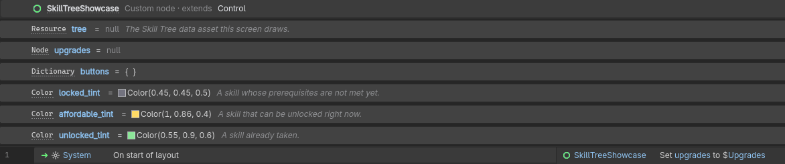
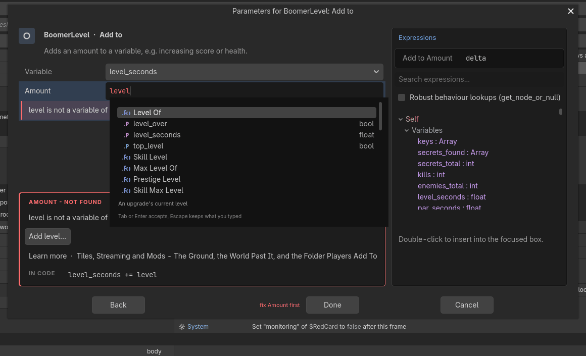

# Godot EventSheets

**Visual event sheets for Godot 4 that compile to plain, readable GDScript.**

The point is **speed-to-game**: whether you've never written code, want logic to pour out faster, or you're mid-jam - events get you from idea to *playing it* in minutes, and keep up when the project balloons to thousands of events.

> [!NOTE]
> **Early.** Every feature ships with tests (34,851 CI-gated assertions across 1013 test files, byte-exact round-trip gates, performance-parity contracts), but the project hasn't yet earned real-world mileage and may see sweeping changes between releases. Pin a release tag and report what you hit - issues are read and acted on.

Godot EventSheets (engine codename *EventForge*, the prefix on internal class names) brings the C3 event-sheet workflow into the Godot editor: a fast visual editor where events read like sentences, and a compiler that turns every sheet into **typed, idiomatic GDScript** - no runtime interpreter, no plugin dependency in your exported game, and **zero performance difference from hand-written code** (a tested contract).

<picture>
  <source media="(prefers-color-scheme: light)" srcset="docs/previews/editor-hero-light.png">
  
</picture>

It is a real Godot workspace, beside 2D / 3D / Script, and it opens an ordinary `.gd` as events: the sheet above *is* `boomer_level.gd`. Behaviours attach as child nodes and expose their knobs in the Inspector like any other node.

## What it compiles to

A sheet isn't interpreted - it **compiles to a plain `.gd` script** you attach and ship. Rows like:

- **On start of layout** → *Print* `"Spawned"`
- **Every tick** · *Keyboard* `"ui_right"` *is down* → *Move by* `Vector2(speed * delta, 0)`
- **Hitbox** · **On collision with** *(body)* · *body in* `"enemy"` → *Subtract* `10` *from health*

become exactly this - typed GDScript with zero references to the plugin:

```gdscript
extends CharacterBody2D

@export var speed: float = 200.0
@export var health: int = 100

func _ready() -> void:
	print("Spawned")

func _process(delta: float) -> void:
	if Input.is_action_pressed(&"ui_right"):
		position += Vector2(speed * delta, 0)

func _on_hitbox_body_entered(body: Node2D) -> void:
	if body.is_in_group("enemy"):
		health -= 10
```

The hit is wired in the scene, not in code: `player.tscn` has an `Area2D` child named `Hitbox` whose `body_entered` signal is connected to `_on_hitbox_body_entered`, so the sheet reads it as a real *On collision with* trigger on the `Hitbox`. The example lives in `demo/readme_example/`.

Delete the plugin and this script still runs. The reverse works too: **open *any* `.gd` as a sheet** - the round-trip is lossless and byte-identical, so you edit visually or in Godot's script editor with the two in sync. Measured with the project's own verify command over 1,647 of this repo's sheet and script files (the deliberately broken test fixtures left out), every one reopens and re-saves byte-for-byte with no answer owed; nearly every code line of the hand-written scripts opens as structure in the sheet's own words; anything the vocabulary cannot match stays an honest, editable row rather than being reformatted behind your back.

**View > Generated GDScript** puts the compiled output beside the sheet, refreshed live as you edit:

<picture>
  <source media="(prefers-color-scheme: light)" srcset="docs/previews/editor-generated-code-light.png">
  
</picture>

## Quick start

1. Copy `addons/eventforge/`, `addons/eventsheet/` and `addons/eventsheet_library/` into your Godot **4.5+** project (tested through **4.7 stable**). The library holds the 140 behavior packs in a folder Godot never imports (it carries a `.gdignore`), so none of them reach Create Node, the picker or your exported game until you add one: the Welcome asks what you are making and copies the packs you pick into `eventsheet_addons/`, and any object's Behaviours list > **+ Add behaviour…** adds more later. Some built-in rows call one of the single scripts at the top of this repository's `eventsheet_addons/` (`free_spot.gd`, `pooled_nodes.gd`, `haptics.gd` and the rest); copy those files into your `eventsheet_addons/` too. Removal is clean - see [uninstall](docs/GUIDE-UNINSTALL.md).
2. **Project Settings → Plugins** → enable **Godot EventSheets**.
3. Open the **EventSheet** tab in the main editor strip (next to 2D/3D/Script).
4. **New… → Platformer Starter**, add events (live search understands C3 phrases like *"every tick"*), and Run.

Everything else is in the **[documentation index](docs/README.md)** and inside the editor (**Tools > Manual**, or F1 on anything selected) - including the [migration guide for Construct users](docs/GUIDE-MOVING-FROM-ANOTHER-EVENT-SHEET-EDITOR.md), [common game patterns](docs/GUIDE-COMMON-GAME-PATTERNS.md), and [using EventSheets with your existing code](docs/GUIDE-USING-WITH-EXISTING-CODE.md).

## Why event sheets in Godot? (honest pros & cons)

**Pros**

- **You ship GDScript, not a black box.** Delete the plugin and your game still runs. Performance parity is a permanent, test-enforced contract.
- **It teaches Godot while you use it.** Every action's tooltip shows the GDScript it generates; ƒx expressions *are* GDScript; the GDScript panel maps every row to its lines and back.
- **Debug it like any GDScript.** Real breakpoints in the generated `.gd`, conditional breakpoints and paused-at-row from the sheet, Live Values / Event Trace on top.
- **A sheet is just `.gd`.** No `.tres`. Open any `.gd` as a sheet, edit it either way, paste GDScript and it converts to events.
- **C3 muscle memory works.** The grammar, the picker, behaviors-as-components and the input/audio vocabularies are designed against C3 conventions on purpose.
- **Scales.** A custom-drawn virtualized viewport keeps 10,000+ rows fluid with no per-row widgets.

**Cons**

- **It's a bridge, not a wall.** Complex logic eventually pulls you toward GDScript by design; to *never* see code, C3 still hides it better.
- **2D-first.** The 3D vocabularies, raycasts and movement packs are real, but deeper 3D still reaches for ƒx.
- **Some C3 plugins have no equivalent** (XML) - routed to the native Godot feature.
- **The first sheet tab of a session is slow** on a large project (about 17 to 22 s on our test machine while Godot compiles the editor; a study of the compile found about 93% of that script cluster is really called, so lazy loading did not shrink it). Interaction is much faster but not done: dropping a drag takes about 0.75 s on an 803-row sheet (it was 2.8 s), and a fold click on a large sheet is under 50 ms (it was about 0.5 s).
- **Experimental.** A large CI suite stands in for mileage it hasn't earned.

The deeper belief, in one line: the condition/action grid is the shape code already has - a trigger is a signal handler, conditions are the `if`, actions are its body, sub-events are nesting - so everything learned in a sheet transfers straight to scripting, and "graduating" to code is noticing you already understand the code your sheets have been writing.

## Feature tour

- **The editor** - two-lane rows, groups, regions, comments, drag/drop, batch edit, full undo/redo; Find & Replace, project-wide Find all references, Outline, Command Palette, type-a-sentence Ghost Row, Properties bar, Simple and Reading modes, themes, split views, session restore. The strip across the top rests as **seven controls** (one Menu over 137 commands, the Save / Undo / Redo icons, one play button holding all six ways to run, Quick add, and a chevron that brings every button back); adding lives in the sheet's own corners. ([guide](docs/GUIDE-THE-TOOLBAR.md))
- **The language** - events, sub-events, Else / Else-if, the full loop and picking set, typed functions, enums, signals, match rows, setters/getters, Script blocks, `await`, autoload sheets, and the Custom Block API for your own row kinds.
- **Any script opens as a sheet** - lifecycle handlers as triggers, input branches as Keyboard/Mouse events, signal wiring as triggers, whole `.tscn` files as composite sheets; a coverage chip says how much reads as events, and every lift is byte-gated.
- **2,249 native ACEs** (108 triggers; 11 more deprecated ids are kept only so old sheets still load) across scenes, spawning, nodes, tweens, audio, cameras, lights, shaders, collisions, raycasts, files, multiplayer, UI, particles, tilemaps, input rebinding and more - plus a Helpers escape hatch so unmapped code stays an editable row.
- **140 behavior packs**, all authored as event sheets - movement and feel, AI, combat and stats, narrative, drawing and UI, lighting, shader effects, and system packs. See [docs/Addons/](docs/Addons/README.md).
- **Your own code is vocabulary with zero setup** - the picker lists your classes and autoloads as Actions / Conditions / Expressions; curate with a project catalog or `## @ace_*` comments; the ACE Studio, Extract to Function and Teach a Verb publish your own; `EventSheets.publish_pack` ships it.
- **The Manual, inside the editor** - Tools > Manual, F1 on anything, a reference page per object and behavior, tutorials you follow in your open sheet, and What's new.
- **Updating never rewrites your sheets** - a superseded verb keeps its id, its line and its place in the picker forever, and carries the address of the newer spelling; migrating, renaming and taking a pack's new version are receipts you read and buttons you press, each one undo step. Four contracts check themselves from a command line. ([guide](docs/GUIDE-UPDATING-AND-REFACTORING.md))
- **Tooling** - Project Doctor (dock / CLI / CI), live debugging (Live Values, Watch, Event Trace, Why didn't this fire?), Save Studio, Translation Studio (nine editor languages), a public [`EventSheets` API](docs/GUIDE-BUILDING-ON-EVENTSHEETS.md) and an opt-in MCP server.

## Current status

The latest tagged release is **`v0.20.0` - "Feel Native"** ([release notes](https://github.com/SalmanShhh/Godot-EventSheet-Visual-Scripting/releases/tag/v0.20.0), [full notes](https://github.com/SalmanShhh/Godot-EventSheet-Visual-Scripting/blob/main/docs/changelog/v0.20.0.md) for the full ledger). It makes the editor sit inside Godot like one of its own docks, and makes it sturdier after a heavy overhaul of how it looks and behaves. In one screen:

- **Editor Native, and names you already know** - a starter look that sits inside Godot like one of its own docks (variables listed the way the Inspector lists a property, blue condition and green action lanes, the compiler's `__` names kept out of sight); the picker answers to `GetComponentInParent`, `WaitForSeconds` and another event-sheet editor's verbs, and an expression field reads `Mathf.Lerp` and `Random.Range`.
- **A sheet that lines up** - words, names and values sit in aligned columns, plain values share one text colour and weight, the parameter band hangs under the function line, branches of a pair are numbered as events of their own, and a function counts as one event in the head card and the status bar.
- **States, class names and described behaviours** - an object's states work project-wide (one state row with a default, descriptions and hover), class names and kinds have authoring steps and autocomplete, and every behaviour variable, state machine and state ships a brief description.
- **Positions say which space they mean** - Set X / Y / Z read relative to the parent, with a hover naming the parent. World twins sit beside them: Set World Position, world X / Y / Z readers, Spawn Scene In The World, and world versions of wrap, bound, glide, push and spawn. The older rows keep working in your sheets but are hidden from the picker (nothing is migrated behind your back). Control nodes get place rows of their own, readings name their space (world, own axes, screen pixels), and the importer maps positions to `global_position` and `angle()` to degrees.
- **Variables say what the Inspector will show** - every export option opens as the variable it belongs to, export groups read as boxes, the variable window is four cards with every look a described choice, and **one Save choice per variable** (Never, Auto, Load only, Save only, Manual) replaces Add Save Support and Remember Between Runs. Values players already saved keep loading through a rename or an update.
- **Making your own** - New behaviour and New global are forms you can reopen later (Behaviour settings…, Global settings…), Add behaviour is a shelf of tiles with yours first, New Data Table is filled in like a spreadsheet, and a script class is made like inserting an object.
- **Functions read like events** - drawn as events on every sheet, edited in Godot's own Inspector, every choice described, and a name or default that would break the script is refused before it is written.
- **The Inspector Designer shapes a field** - Look, Layout, Show when, Check, Help and Button: groups as tabs, two fields side by side, a dropdown filled by a function, picking a row of a data table by name, and search, sort and pages for big tables. All of it is plain GDScript that works without the plugin.
- **Groups and regions** - one group head in every look, a group picked by name when an event switches it (a rename takes those rows along), its colour saved with the script, regions that fold, and a broken `#region` shown as a quiet amber row.
- **Studios** - the Save studio's files, slots, look-inside and player-settings tabs; the Translation Studio as four steps, a table that stays fast at a million lines, and catalogs you wrote by hand never rewritten.
- **Your code opens as rows, and so does the plugin's** - functions written inside a call, classes inside a script, values over several lines and statements continued with `\` now open as rows, byte-exact, and the plugin's own scripts open the same way with no block of code on screen.
- **New rows, each the Godot way** - Tell Children, First Parent Of Type, Next / Previous Sibling, Reset Variable(s), Pick First / Last Where, Has Been True For, **pause requests** (the game stays paused until everyone who asked lets go), and the **Flock** and **Flock 3D** packs.
- **Truer error checking** - a property the host class really has (`global_position`, `position`, a Control's size) is no longer flagged as an unknown variable.
- **Faster** - the editor starts in about 11 s instead of 30, the picker lists every pack verb (it had shown 142 of 4,477), and CI answers in about four minutes instead of twenty. A performance pass on the sheet itself, measured on the largest shipped pack (pathfinding): the saved-names badge went from 6.1 s to 9 ms, a save's diagnostics from 12.4 s to 0.8 s, the draw of a 1,516-row sheet from 44.6 to 24.4 ms, a full row rebuild from 13.7 to 9.4 s, and reopening an unchanged `.gd` skips the lift (10.6 s to 1.3 s, from a byte-checked cache in `.godot/`); rows now get their words as they scroll into view.
- **Smooth interaction** - measured in the real editor (frame p90): hovering a small sheet went from 26 to 7.7 ms, dragging from 83 to 13.2 ms, dragging on an 803-row sheet from 60 to 9.4 ms, and a fold click on those 803 rows from 6.07 to 0.51 s, and later to under 50 ms; dropping a drag on that sheet went from 2.8 to about 0.75 s. Each row keeps its own recorded drawing instead of being redrawn. Disabling the plugin now frees its workspace.
- **Colour values you can see** - every Color form (Godot's named colours, hex, numbers, HSV, `Color.html` and more) shows a square of the colour in the value's text; click it for Godot's own ColorPicker, with no parameters window. The value keeps the form you typed, and **Read Colours As** and **Copy As** change how colours read or copy.

  <picture>
    <source media="(prefers-color-scheme: light)" srcset="docs/previews/editor-colour-values-light.png">
    
  </picture>

- **Type checking as you type** - Godot's own analyzer checks what you write against typed stand-ins, answers in a plain sentence plus Godot's own words, underlines the exact span, and an error blocks OK and Enter.

  <picture>
    <source media="(prefers-color-scheme: light)" srcset="docs/previews/editor-type-check-light.png">
    
  </picture>

- **Autocomplete that follows the code** - dot completion through chains and built-in values, argument hints that follow the receiver, names inside quotes, and descriptions taken from Godot's class reference.

  <picture>
    <source media="(prefers-color-scheme: light)" srcset="docs/previews/editor-autocomplete-light.png">
    
  </picture>

- **Mistake checks with a fix beside each** - a wrong node type, a `res://` path that is missing, an empty group, an input action that does not exist, a `$Path` that is not in the scene, a signal given the wrong number of values, a While that cannot end, a local hiding a variable or parameter, and a division by a literal zero. Each shows on the row's quiet state with its fix door, and in the Doctor.
- **Checks on save** - a broken script marks its row with Godot's own words, and compiler warnings reach the row. A run-time error in a `.gd` sheet or a hand-written script reaches the sheet's strip and Jump selects its row, in a game started from the editor, through the editor's own debugger feed, with nothing added to the game (a game you start outside the editor has no feed to read).

### On `main` since `v0.20.0`, not yet tagged

51 commits, every one listed in the [CHANGELOG](CHANGELOG.md) under `[Unreleased]`, CI green. In one screen:

- **More of your code opens as rows** - measured on the 459 scripts of Godot's official demo projects, all of which open and save back byte for byte: a statement written over several lines is one row, `#` notes are comment rows or the note of the action under them, a note at the end of a line stays with its line, constants and plain variables at the top of a script are variable rows, and `signal name()` is a signal row. The cells still drawn as code fell from 1,510 to 1,183 of about 25,000, most of the rest being blank spacing lines.
- **Stacks and queues** - Pop back / Pop front into a name (with an optional If empty fallback, and a typed result from a typed list), Move back / front / all between lists, Swap, For each popped from the front, and Push back keeping the last N, under Stack and Queue groups in the picker. All plain `Array` calls.
- **Lists of instances, and picking** - a pick lasts for its event and its sub-events: the picked instance is offered as an object in Add action by its type, its rows read under that type, and an event outside the pick says so. Push back once, Set a list to the instances in a group, Drop freed instances. A list of nodes nothing reads in order is pointed at a group, Godot's own tool for a set of nodes, with a door that converts it.
- **Godot's own drawing calls** - `draw_line`, `draw_rect`, `draw_circle`, `draw_arc`, `draw_string`, `draw_texture` and the rest as actions under On Draw, with optional arguments left off when unused, plus Redraw.
- **Your own functions edit like events** - a function in a script you opened has no lock; a shipped behaviour pack asks once before its first edit, because a newer version of the pack would replace it; the choice is remembered for the project and never written into the `.gd`. Dragging an action inside a function moves it.
- **Reads for what it is** - `_process` is Every tick and `_physics_process` is Every physics tick; `delta` reads as `delta`; an untyped variable reads `any`; a list row reads under its list.
- **Quieter windows and rows** - the help card and field notes are plain panels with no coloured outline, a finding tints its row and colours the event number without a frame, and a long finding sentence wraps so it is read whole.
- **Fixed** - a restored session read every tab but the last as raw function blocks; the parameters window could write a call with a gap in the middle; the kind check built a broken test script from a `match` arm.
- **Examples** - the README's player example is real Godot (a Hitbox `Area2D` wired in the scene), and the Family Arena showcase has each enemy move itself while the arena only spawns them and runs the family-wide strike.

**Measured** - on our test machine this week: enabling the plugin takes **310 to 450 ms**, and the first sheet tab of a session **17 to 22 s** (about 30 s at `v0.18.0`; it is still the slowest moment, most of it Godot compiling the editor's own scripts). More interaction and first-open work is in progress.

**Quality** - the full test suite and CI run on every push; byte-exact golden round-trips guard the lossless rules; generated code never depends on the plugin and is performance-identical to hand-written GDScript - all test-enforced. **Verified on Godot 4.7 stable.**

## Milestones

Every release has full notes in its own file under [docs/changelog](https://github.com/SalmanShhh/Godot-EventSheet-Visual-Scripting/tree/main/docs/changelog), indexed in [CHANGELOG.md](CHANGELOG.md); the one-line themes:

| Release | Theme |
|---|---|
| `v0.1` - `v0.5` | Editor + compiler + lossless pairing, rich variables, C3 coverage, 3D vocabulary, breakpoints, Audio, node picker |
| `v0.6` - `v0.8` | Inspector attributes, addon composition, Live Values, singleton sheets; Rename Everywhere, snippets, if/elif/else reverse-lift; Godot 4.7, merge driver, Find References, opt-in MCP |
| `v0.9.0` / `v0.9.5` | Frame-spreading, Juice, code-free authoring, first-class UI / raycast / particles / tilemaps / shaders; `.gd`-default sheets, `@export` variables + drawers |
| `v0.10.0` | In-sheet authoring: ACE Studio, per-function shell-lift, Ghost Row, error→row, the Custom Block API |
| `v0.11.0` | Structure and vocabulary: regions, Look Gallery, localisation vocabulary, terse providers, Extract / Teach a Verb, the public `EventSheets` API |
| `v0.12.0` | The Inspector Designer: eight drawers, custom resources, HUD Kit / Scene Flow / Dialogue Kit, a lazily-built editor |
| `v0.13.0` | Genre toolkits: the idle kit, ECS-lite Systems, Advanced Random behind one seed, auto-registering pack builders |
| `v0.14.0` | Pathfinding and game feel: Platformer Pathfinding + Nav Agent 3D, the AI drive seam, FPS movement tech, Juice cameras, the Input Map picker, a ~21x faster boot |
| `v0.15.0` | Save anything: the save-state seam on 18 packs, six formats, the Save Studio, the player-or-AI input seam, BBCode comments |
| `v0.16.0` | Open anything, publish anything: nine editor languages, the Custom Resource wizard, `publish_pack`, the reads-like-code pass, 88 raycasting verbs + two labs, the curation pass |
| `v0.17.0` | Adopt anything, read anything: real `.gd` files open as rows byte-exact, your classes as vocabulary, Construct-style reading, the pattern / dev-experience / i18n waves, docs inside the editor |
| `v0.18.0` | Refactor anything, render anything, feel everything: the refactor contract, states and scenes as rows, the render vocabulary and shape nodes, the Feedback Player, the gameplay systems, the resting toolbar and the Manual |
| `v0.20.0` | Feel native: the Editor Native look in Godot's light and dark themes, names you already know, variables as the Inspector shows them, one Save choice per variable, functions as events, the Inspector Designer shaping a field, world and local positions, type checking, autocomplete, colour squares and mistake checks as you type, smooth interaction on big sheets, every `.gd` save loss fixed |
| _Unreleased on main_ | More code opening as rows (multi-line statements, notes, constants), stacks and queues, lists of instances and picking that lasts for its event, Godot's drawing calls as actions, functions that edit like events, plainer windows |
| _Next_ | Four small `.gd` save details (where a comment row is written, a comment's colour, a plain variable's description, a `#region` around the top events), dropping a drag on a big sheet under a frame or two (about 0.75 s on 803 rows today, a fold click is already under 50 ms), a first sheet tab in seconds (about 17 to 22 s today), saving a behaviour or global decided when you make it, then whatever you ask for |

## Project layout

| Path | What it is |
|---|---|
| `addons/eventforge/` | Data model, compiler, importer, builtin ACEs, runtime bridge |
| `addons/eventsheet/` | The editor: dock, virtualized viewport, renderer, picker, themes, lint, the Manual, MCP server |
| `eventsheet_addons/` | Zero-config ACE addons + the 140 behavior packs, as this repository's own project uses them (built from `tools/pack_builders/`) |
| `addons/eventsheet_library/` | The same packs as the library a game adds them from, behind a `.gdignore` (written by `tools/build_library.gd`) |
| `demo/` | 30 showcases (each a `.gd` that is BOTH the sheet and the compiled script, with a scene where it is playable) and the bundled themes |
| `tests/` | Headless suite - `run_tests.gd` (full) and `run_perf.gd` (fast gate) |
| `docs/` | Contract specs + guides (migration, recipes, MCP, glossary, uninstall) |

## Verifying a change

```text
godot --headless --path . --script tests/run_perf.gd     # fast, headless-safe suite
godot --headless --path . --script tests/run_tests.gd    # full suite
```

Every feature lands with tests, a CHANGELOG entry, and its spec updated. Pushes and PRs run the headless suite; pushing a `v*` tag stamps `plugin.cfg` and publishes a GitHub Release.

## Contributing & license

[CONTRIBUTING.md](CONTRIBUTING.md) has the dev setup, the compatibility covenant, and how to add ACEs, addons, packs, and themes. The project improves fastest through real-world reports - [open an issue](../../issues/new/choose) if something breaks or a C3 workflow feels wrong. MIT licensed (`LICENSE`).

## 🙏 Acknowledgments

This plugin stands on the shoulders of the tools that made visual, code-optional game logic mainstream:

- **[Construct](https://www.construct.net/)** - the direct inspiration. The event-sheet grammar, the ACE (Action / Condition / Expression) model, the picker, and behaviors-as-components are all designed against Construct 3's conventions on purpose, so C3 muscle memory carries over.
- **[Clickteam Fusion 2.5](https://www.clickteam.com/clickteam-fusion-2-5)** - a foundational event-editor whose event-grid lineage shaped the whole "events read like sentences" idea.
- **[Scratch](https://scratch.mit.edu/)** - for proving that visual, block-based programming is a real on-ramp to building software, not a toy.
- **[Godot Engine](https://godotengine.org/)** - the open-source engine this is built on and for; every sheet compiles to plain, idiomatic GDScript that runs with zero dependency on this plugin.

These are independent projects and trademarks of their respective owners; this plugin is not affiliated with or endorsed by any of them.

## 🤖 AI Use Disclosure

**This project is built with heavy use of AI tooling, and I want that to be completely clear
up front - not something you discover later.** Much of the implementation work across the
plugin's code, the bundled behavior packs, the documentation, and the test suite was produced
with large language models. The direction, design, and domain knowledge are mine: what to
build, how event sheets should feel, which C3 conventions matter and why, what is correct
Godot practice, and what ships versus what gets rejected. Every change is reviewed and gated
by the project's own verification: the full test suite, byte-exact round-trip checks on
generated code, and rendered previews of UI work.

It started as a pet project and it still is one: an experiment to see whether a full
visual-scripting solution could actually be built this way - steering AI with deep
domain-specific knowledge of event sheets (Construct, Clickteam Fusion, GDevelop lineage)
and of Godot itself - and how far that approach could carry a real, working tool. This
repository is the honest answer so far.

**If you choose not to use this addon because of ethical concerns about AI, that is a
completely legitimate choice and I respect it fully - no argument, no judgment, and no hard
feelings.** People draw this line in different places for real reasons, and I do not fault
anyone for drawing it somewhere other than where I did. The project is MIT licensed and will
still be here if that ever changes; if it does not, I wish you well and thank you for reading
this far.
