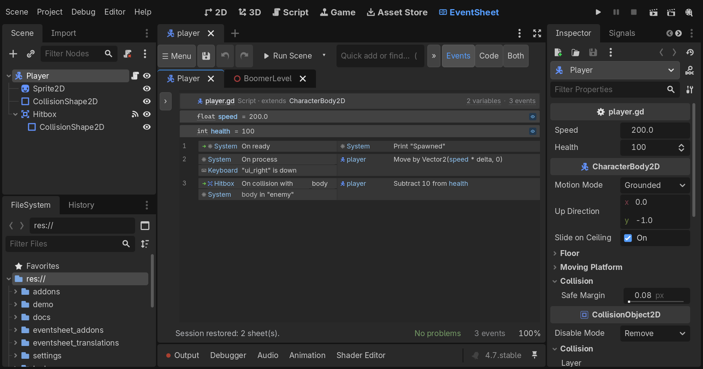
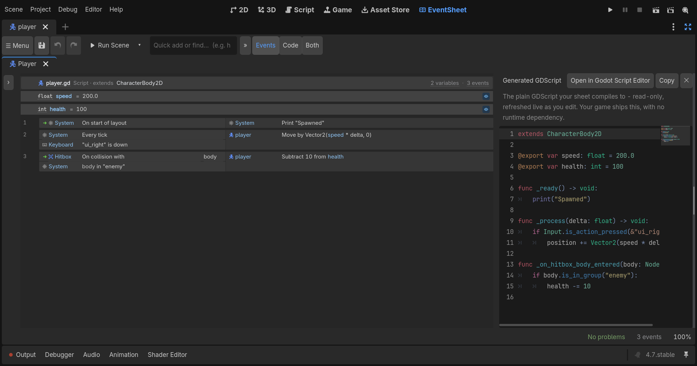
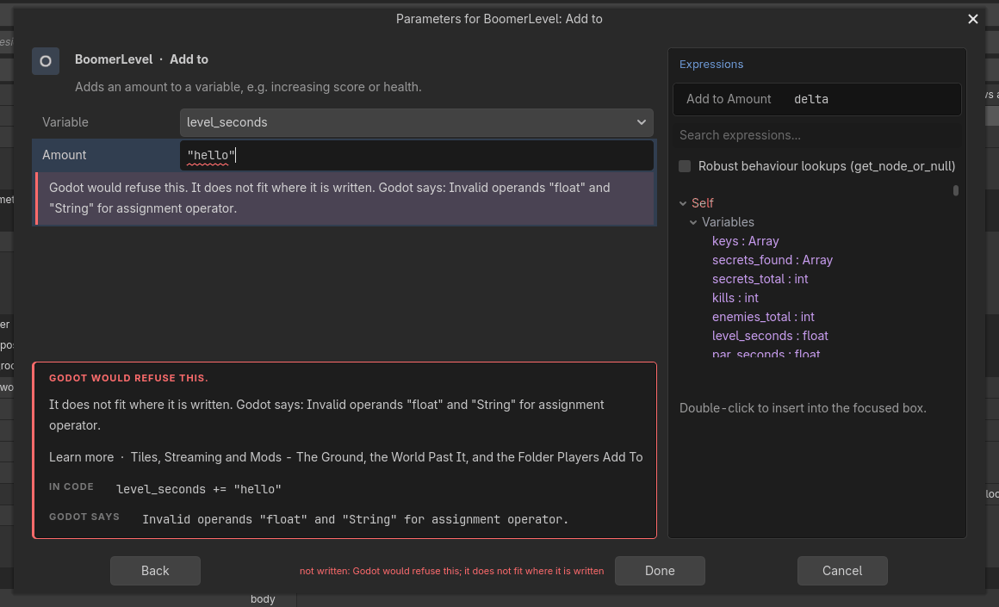

# Godot EventSheets

**Visual event sheets for Godot 4 that compile to plain, readable GDScript.**

The point is **speed-to-game**: whether you've never written code, want logic to pour out faster, or you're mid-jam - events get you from idea to *playing it* in minutes, and keep up when the project balloons to thousands of events.

> [!NOTE]
> **Early.** Every feature ships with tests (over 1,000 test files gated in CI, byte-exact round-trip gates, performance-parity contracts), but the project hasn't yet earned real-world mileage and may see sweeping changes between releases. Pin a release tag and report what you hit - issues are read and acted on.

Godot EventSheets (engine codename *EventForge*, the prefix on internal class names) brings the C3 event-sheet workflow into the Godot editor: a fast visual editor where events read like sentences, and a compiler that turns every sheet into **typed, idiomatic GDScript** - no runtime interpreter, no plugin dependency in your exported game, and **zero performance difference from hand-written code** (a tested contract).

<picture>
  <source media="(prefers-color-scheme: light)" srcset="docs/previews/editor-hero-light.png">
  
</picture>

It is a real Godot workspace, beside 2D / 3D / Script, and it opens an ordinary `.gd` as events: the sheet above *is* `boomer_level.gd`. Behaviours attach as child nodes and expose their knobs in the Inspector like any other node.

## What it compiles to

A sheet isn't interpreted - it **compiles to a plain `.gd` script** you attach and ship. Rows like:

- **On ready** → *Print* `"Spawned"`
- **On process** · *Keyboard* `"ui_right"` *is down* → *Move by* `Vector2(speed * delta, 0)`
- **Hitbox** · **On collision with** *(body)* · *body in* `"enemy"` → *Subtract* `10` *from health*

become exactly this - typed GDScript with zero references to the plugin:

```gdscript
extends CharacterBody2D

@export var speed: float = 200.0
@export var health: int = 100

func _ready() -> void:
	print("Spawned")

func _process(delta: float) -> void:
	if Input.is_action_pressed(&"ui_right"):
		position += Vector2(speed * delta, 0)

func _on_hitbox_body_entered(body: Node2D) -> void:
	if body.is_in_group("enemy"):
		health -= 10
```

The hit is wired in the scene, not in code: `player.tscn` has an `Area2D` child named `Hitbox` whose `body_entered` signal is connected to `_on_hitbox_body_entered`, so the sheet reads it as a real *On collision with* trigger on the `Hitbox`. The example lives in `demo/readme_example/`.

Delete the plugin and this script still runs. The reverse works too: **open *any* `.gd` as a sheet** - the round-trip is lossless and byte-identical, so you edit visually or in Godot's script editor with the two in sync. Measured with the project's own verify command over 1,647 of this repo's sheet and script files (the deliberately broken test fixtures left out), every one reopens and re-saves byte-for-byte with no answer owed; nearly every code line of the hand-written scripts opens as structure in the sheet's own words; anything the vocabulary cannot match stays an honest, editable row rather than being reformatted behind your back.

**View > Generated GDScript** puts the compiled output beside the sheet, refreshed live as you edit:

<picture>
  <source media="(prefers-color-scheme: light)" srcset="docs/previews/editor-generated-code-light.png">
  
</picture>

## Quick start

1. Copy `addons/eventforge/`, `addons/eventsheet/` and `addons/eventsheet_library/` into your Godot **4.5+** project (tested through **4.7 stable**). The library holds the 140 behavior packs in a folder Godot never imports (it carries a `.gdignore`), so none of them reach the picker or your exported game until you add one: the Welcome asks what you are making and copies the packs you pick into `eventsheet_addons/`, and Godot's own **Create Node** window and the Behaviour library add more later. A few built-in rows (a free-spot spawn, a retire, a bus mix) call a small script of their own; the plugin carries those too and copies one into `eventsheet_addons/` the moment you apply a row that needs it. Removal is clean - see [uninstall](docs/GUIDE-UNINSTALL.md).
2. **Project Settings → Plugins** → enable **Godot EventSheets**.
3. Open the **EventSheet** tab in the main editor strip (next to 2D/3D/Script).
4. **New… → Platformer Starter**, add events (live search also understands other editors' words like *"every tick"*), and Run.

Everything else is in the **[documentation index](docs/README.md)** and inside the editor (**Menu > Manual**, or F1 on anything selected) - including the [migration guide for Construct users](docs/GUIDE-MOVING-FROM-ANOTHER-EVENT-SHEET-EDITOR.md), [common game patterns](docs/GUIDE-COMMON-GAME-PATTERNS.md), and [using EventSheets with your existing code](docs/GUIDE-USING-WITH-EXISTING-CODE.md).

## Why event sheets in Godot? (honest pros & cons)

**Pros**

- **You ship GDScript, not a black box.** Delete the plugin and your game still runs, at the speed of hand-written code. Both are test-enforced.
- **Your existing scripts open as sheets.** Any `.gd` opens as rows and saves back byte for byte, so you can adopt it one file at a time and leave at any time.
- **It teaches Godot while you use it.** Every row shows the GDScript it writes, expressions are GDScript, and mistakes are explained on the row with a fix beside them.
- **Familiar if you come from another event-sheet editor.** The grammar, the picker, behaviours as components and picking work the way you expect, on Godot's own nodes, signals and groups. The sheet speaks Godot's words by default; the other editors' words are one opt-in away.
- **Debug it like any script.** Real breakpoints, paused-at-row, Live Values and an Event Trace.
- **It stays fast.** A custom-drawn sheet keeps 10,000+ rows fluid.

**Cons**

- **It is a bridge, not a wall.** Complex logic eventually pulls you toward GDScript, by design.
- **2D-first.** The 3D vocabularies are real, but deeper 3D still reaches for expressions.
- **The first sheet tab of a session is slow** on a large project (about 17 to 22 s on our test machine). After that, editing is smooth.
- **Experimental.** A large CI suite stands in for mileage it has not earned yet.

## Feature tour

- **The editor** - two-lane event rows, groups, regions, comments, drag and drop, full undo; Find and Replace, find all references, a Go to window (Ctrl+P) with every command on Godot's own Command Palette, themes that follow Godot's light and dark editor.
- **The language** - events, sub-events, Else, loops and picking, typed functions, enums, signals, `match`, `await`, and a Custom Block API for your own row kinds.
- **Any script opens as a sheet** - handlers as triggers, input branches as events, signal wiring as triggers; every reading is gated by saving back the same bytes.
- **2,302 native ACEs** (108 triggers) across scenes, spawning, tweens, audio, cameras, lights, shaders, collisions, raycasts, files, multiplayer, UI, particles, tilemaps and input.
- **140 behavior packs**, all authored as event sheets: movement, AI, combat, narrative, drawing, lighting, shaders. See [docs/Addons/](docs/Addons/README.md).
- **Your own code is vocabulary** - the picker lists your classes and autoloads as actions, conditions and expressions with zero setup.
- **Mistakes caught as you type** - type checking with Godot's own analyzer, autocomplete that follows the code, and checks for the errors Godot only reports when the game runs.

  <picture>
	<source media="(prefers-color-scheme: light)" srcset="docs/previews/editor-type-check-light.png">
	
  </picture>

- **Tooling** - Project Doctor (dock, CLI, CI), live debugging, Save Studio, Translation Studio (nine editor languages), the Manual inside the editor, a public [`EventSheets` API](docs/GUIDE-BUILDING-ON-EVENTSHEETS.md) and an opt-in MCP server.
- **Updating never rewrites your sheets** - a superseded row keeps working forever and carries the address of its replacement. ([guide](docs/GUIDE-UPDATING-AND-REFACTORING.md))

## Current status

The latest tagged release is **`v0.20.0` - "Feel Native"** ([release notes](https://github.com/SalmanShhh/Godot-EventSheet-Visual-Scripting/releases/tag/v0.20.0), [full notes](https://github.com/SalmanShhh/Godot-EventSheet-Visual-Scripting/blob/main/docs/changelog/v0.20.0.md)): the Editor Native look in Godot's light and dark themes, names you already know, type checking, autocomplete and mistake checks as you type.

### In the works for the next release

**Already on `main`** (81 commits since the tag, CI green, each in the [CHANGELOG](CHANGELOG.md)):

- **Godot's words by default.** On ready, On process, scene, group, Queue free, Instantiate; the other editors' words are an opt-in Familiar preset and still work as search.
- **Behaviours are added through Godot's own Create Node window** and a Behaviour library, and the ones you tune by eye have a Preview button that never changes your saved scene.
- **The everyday object rows**, a correct on-screen check, and Godot groups in place of marks.
- **Fewer panels.** The plugin panels that repeated Godot's own docks are gone, and a Doctor check warns when a behaviour sits under the wrong kind of node (with an optional "Acts on").
- **More of your code opens as rows**, plus stacks, queues and lists of instances, Godot's own drawing calls as actions, and your own functions editing like events.

**Designed, next in line:**

- **Building at run time** - spawn and keep hold of what you made, add nodes and behaviours, turn behaviours on and off, and build prefabs from parts.
- **Custom inspectors made and improved as event sheets.**

**Measured** on our test machine: enabling the plugin takes **310 to 450 ms**; the first sheet tab of a session **17 to 22 s** (about 30 s at `v0.18.0`).

**Quality** - the full test suite and CI run on every push; byte-exact round-trips guard your files; generated code never depends on the plugin. **Verified on Godot 4.7 stable.**

## Milestones

Every release has full notes under [docs/changelog](https://github.com/SalmanShhh/Godot-EventSheet-Visual-Scripting/tree/main/docs/changelog), indexed in [CHANGELOG.md](CHANGELOG.md).

| Release | Theme |
|---|---|
| `v0.1` - `v0.9.5` | The editor, the compiler and lossless `.gd` pairing; 3D, audio, UI, tilemaps, shaders; `.gd` as the default sheet format |
| `v0.10` - `v0.13` | In-sheet authoring, the Custom Block API, the public `EventSheets` API, the Inspector Designer, genre toolkits |
| `v0.14` - `v0.16` | Pathfinding and game feel, save anything, nine editor languages, raycasting |
| `v0.17.0` | Adopt anything: real `.gd` files open as rows byte-exact, your classes as vocabulary |
| `v0.18.0` | Refactor anything, render anything, feel everything |
| `v0.20.0` | Feel native: the Editor Native look, type checking, autocomplete and mistake checks |
| _Next_ | See "In the works" above |

## Project layout

| Path | What it is |
|---|---|
| `addons/eventforge/` | Data model, compiler, importer, builtin ACEs, runtime bridge |
| `addons/eventsheet/` | The editor: dock, virtualized viewport, renderer, picker, themes, lint, the Manual, MCP server |
| `eventsheet_addons/` | Zero-config ACE addons + the 140 behavior packs, as this repository's own project uses them (built from `tools/pack_builders/`) |
| `addons/eventsheet_library/` | The same packs as the library a game adds them from, behind a `.gdignore` (written by `tools/build_library.gd`) |
| `demo/` | 30 showcases (each a `.gd` that is BOTH the sheet and the compiled script, with a scene where it is playable) and the bundled themes |
| `tests/` | Headless suite - `run_tests.gd` (full) and `run_perf.gd` (fast gate) |
| `docs/` | Contract specs + guides (migration, recipes, MCP, glossary, uninstall) |

## Verifying a change

```text
godot --headless --path . --script tests/run_perf.gd     # fast, headless-safe suite
godot --headless --path . --script tests/run_tests.gd    # full suite
```

Every feature lands with tests, a CHANGELOG entry, and its spec updated. Pushes and PRs run the headless suite; pushing a `v*` tag stamps `plugin.cfg` and publishes a GitHub Release.

## Contributing & license

[CONTRIBUTING.md](CONTRIBUTING.md) has the dev setup, the compatibility covenant, and how to add ACEs, addons, packs, and themes. The project improves fastest through real-world reports - [open an issue](../../issues/new/choose) if something breaks or a C3 workflow feels wrong. MIT licensed (`LICENSE`).

## 🙏 Acknowledgments

This plugin stands on the shoulders of the tools that made visual, code-optional game logic mainstream:

- **[Construct](https://www.construct.net/)** - the direct inspiration. The event-sheet grammar, the ACE (Action / Condition / Expression) model, the picker, and behaviors-as-components are all designed against Construct 3's conventions on purpose, so C3 muscle memory carries over.
- **[Clickteam Fusion 2.5](https://www.clickteam.com/clickteam-fusion-2-5)** - a foundational event-editor whose event-grid lineage shaped the whole "events read like sentences" idea.
- **[Scratch](https://scratch.mit.edu/)** - for proving that visual, block-based programming is a real on-ramp to building software, not a toy.
- **[Godot Engine](https://godotengine.org/)** - the open-source engine this is built on and for; every sheet compiles to plain, idiomatic GDScript that runs with zero dependency on this plugin.

These are independent projects and trademarks of their respective owners; this plugin is not affiliated with or endorsed by any of them.

## 🤖 AI Use Disclosure

**This project is built with heavy use of AI tooling, and I want that to be completely clear
up front - not something you discover later.** Much of the implementation work across the
plugin's code, the bundled behavior packs, the documentation, and the test suite was produced
with large language models. The direction, design, and domain knowledge are mine: what to
build, how event sheets should feel, which C3 conventions matter and why, what is correct
Godot practice, and what ships versus what gets rejected. Every change is reviewed and gated
by the project's own verification: the full test suite, byte-exact round-trip checks on
generated code, and rendered previews of UI work.

It started as a pet project and it still is one: an experiment to see whether a full
visual-scripting solution could actually be built this way - steering AI with deep
domain-specific knowledge of event sheets (Construct, Clickteam Fusion, GDevelop lineage)
and of Godot itself - and how far that approach could carry a real, working tool. This
repository is the honest answer so far.

**If you choose not to use this addon because of ethical concerns about AI, that is a
completely legitimate choice and I respect it fully - no argument, no judgment, and no hard
feelings.** People draw this line in different places for real reasons, and I do not fault
anyone for drawing it somewhere other than where I did. The project is MIT licensed and will
still be here if that ever changes; if it does not, I wish you well and thank you for reading
this far.
