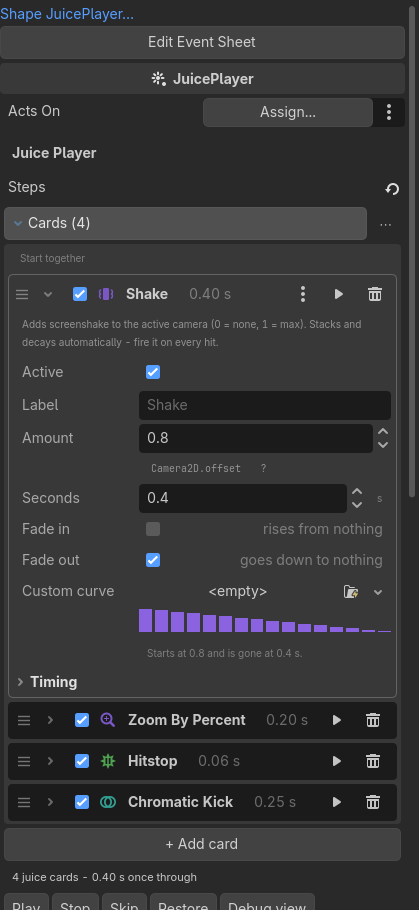

# Composing Juice: The Beat A Hit Is Made Of

A hit that lands well is never one thing. It is a shake, a freeze, a flash, a crunch, a rumble in
the hand and the health bar catching up a moment later, and the reason it feels good is that those
things happen in an order, at different strengths, at different distances. Writing that out as six
timers and a boolean per effect is how most games do it, and it is why nobody ever tunes it twice.

This guide is the other way: **a beat is written down, once, as rows**, and then it is played by
name. It covers the Moment block and its four timing words, the Juice Player and the list of
cards an object carries, the rows that edit that list while the game runs, strength and place and
range, playing a beat backwards or turning it around mid-play, channels, springs and curves under
any property, blink patterns, audio sweeps and mix snapshots, haptics, the sequencer, and a bar
whose underlay trails the value down. It closes with what all of it costs on a phone and in a
browser tab.

Everything here is ordinary Godot underneath: signals, groups, tweens, resources and plain typed
GDScript in your own project folder. Nothing invents a parallel environment to learn.

## Table of Contents

- [Three homes, one shape](#three-homes-one-shape)
- [The Moment block, and its four timing words](#the-moment-block-and-its-four-timing-words)
- [Where it happened, and how far it reaches](#where-it-happened-and-how-far-it-reaches)
- [Backwards, reverted, skipped, put back](#backwards-reverted-skipped-put-back)
- [What a beat says while it plays](#what-a-beat-says-while-it-plays)
- [The Juice Player: the list an object carries](#the-juice-player-the-list-an-object-carries)
- [A card of your own](#a-card-of-your-own)
- [Finding what went wrong](#finding-what-went-wrong)
- [Every card, by its label](#every-card-by-its-label)
- [Channels: one row heard by everything listening](#channels-one-row-heard-by-everything-listening)
- [Springs under any property](#springs-under-any-property)
- [Curves you own](#curves-you-own)
- [Blink: a rhythm as a file](#blink-a-rhythm-as-a-file)
- [The room going under: audio sweeps and snapshots](#the-room-going-under-audio-sweeps-and-snapshots)
- [Haptics: a shape in the hand](#haptics-a-shape-in-the-hand)
- [The sequencer: a grid of moments on a beat](#the-sequencer-a-grid-of-moments-on-a-beat)
- [A bar that lags](#a-bar-that-lags)
- [What a beat costs on a phone and in a browser](#what-a-beat-costs-on-a-phone-and-in-a-browser)

---

## Three homes, one shape

A beat is a list of felt things, each with how much, which extra word, and how long. That list has
three homes, and they hold the same shape:

| Home | What it is | Best for |
| --- | --- | --- |
| A **moment file** (`MomentResource`) | A `.tres` in your project holding the steps | A beat several objects share: the standard hit, the standard death |
| A **Juice Player** node | A node under one object, whose Inspector is the list | This object's own beat: this enemy's hit, this button's hover |
| A **Moment block** | A block of rows in the sheet, its children the steps | A beat with timing in it, read in the sheet beside the event that fires it |

All three are played by the same runner, so a beat behaves identically wherever it was written, and
there are doors between them: **Save Moment As File** writes a block or a player's list out, and
**Open Moment File As Block** and **Load Moment File** read one back in.

Pick the home by who the beat belongs to, not by what it does. Six starter files ship beside the
Juice pack - `impact`, `kill`, `triumph`, `danger`, `calm` and `cut` - and they are ordinary
resources: open one, retune it, rename it, duplicate it, or delete all six. There is no house set of
beats anywhere in the plugin, because how a game feels is the game's.

---

## The Moment block, and its four timing words

A file is the right home for a beat whose steps all happen at once. A beat with **timing** in it -
the shake now, the sound a frame later, the scale settling only once the sound has finished - wants
to be read in order. That is a **Moment block**: a block whose children are its steps, a timing word
on the left and any actions at all on the right.

```
Moment  impact  (strength, from)
  At 0 s            -> Enemy | JuiceBehavior: Moment Step  "shake"  0.4
  At 0.05 s         -> Enemy | Audio: Play Sound  "hit.ogg"
  Then 0.02 s       -> Enemy | JuiceBehavior: Moment Step  "flash"  1.0
  Hold, then 0.1 s  -> Enemy | Tween: Tween Property  "scale"  Vector2(1, 1)  over 0.2 s
```

| Word | When the step runs |
| --- | --- |
| **At** | That many seconds after the moment began. Two steps At the same number happen together. |
| **Then** | That many seconds after the step above it started. |
| **Hold** | When the slowest step above has finished, plus a delay of its own. |
| **Loop Back** | Back to the last Hold (or the top) for that many more passes. |

In a Juice Player's list a Hold can also be told to wait for one card above it, by name, and then it waits for that card alone. A step that says how long it **lasts** is what a Hold waits for; a step that says nothing counts as
instant, which is the common case. Each step also picks its clock: game time follows `time_scale`,
so a slowmo stretches the beat with everything else, while real time ignores it, which is what the
step after a hitstop wants.

The block compiles to one ordinary coroutine on the host,
`func moment_impact(strength: float = 1.0, from: Node = null)`, so what the sheet plays is a
function a hand-written script could have held - and a hand-written one of that shape opens back as
the block. **Moment "impact"** plays it: the row looks for a moment written as rows on the host
first and falls through to a file when there is none, so a game can keep some of its beats in files
and write the rest down in the sheet without either row knowing the difference.

Reorder the steps by dragging the rows, the way you reorder any rows. There is no widget inside the
block to press: the play, stop, skip and restore buttons live on the resting toolbar's **Moment**
segment, which appears while a row about a beat is selected.

---

## Where it happened, and how far it reaches

A moment played on every enemy in a room is one beat felt ten times over. **Play Moment At** takes a
place and a range instead: the strength falls off between the two, and a moment that happened
outside the range does not play at all.

```
On Bomb exploded
  -> Player | JuiceBehavior: Play Moment At  "kill"  1.0  from *Bomb*  within 600  (smooth)
  -> Player | JuiceBehavior: Set Moment Strength  Settings.effect_strength
```

The falloff is a word on the row: `linear` is a straight line to the edge, `smooth` rounds the
shoulders so a near blast keeps more of itself, and `none` holds full strength right up to the edge.
The distance is measured once per play, from the place to whoever is watching - the active camera,
or the host itself in a game with no camera. A range of `0` is no range at all: the moment plays
everywhere, at full strength.

**Set Moment Strength** is the other dial: one number every moment this node plays is scaled by, for
a quiet scene at `0.4`, a boss fight at `1.5`, or whatever the player chose in the options menu.
**Moment Strength** answers what that number currently is, which is what the options slider reads to
draw itself.

---

## Backwards, reverted, skipped, put back

A hover-in and a hover-out are one beat played two ways. An intro somebody has seen twenty times is
a beat they want to be over. A scene on its way out wants everything a beat moved put back. Four
rows cover all of it, and none of them needs a second beat kept in step with the first by hand.

```
On Card mouse entered
  -> Card | JuiceBehavior: Moment  "hover"  1.0
On Card mouse exited
  -> Card | JuiceBehavior: Revert Moment  "hover"
On Skip pressed
  -> Game | JuiceBehavior: Skip Moment To End  "intro"
On Level exiting
  -> Game | JuiceBehavior: Restore Moment Values  ""
```

**Play Moment Backwards** plays the beat from its last step to its first. Every step is in the walk
either way, and the amounts are scaled and held to the no-flashing ceiling exactly as they are
forwards.

**Revert Moment** turns a beat that is *still playing* around from where it is. Every value its
steps wrote walks home to what it was when the beat began, over the beat's own length, so a
hover-out does not have to know how far the hover-in got. The steps that cannot be undone - a shake
already felt, a hitstop already let go - are stepped over on the way back rather than fired again.

**Skip Moment To End** ends the beat now, on the values it would have finished on: a held effect
lands at full strength, a freeze lets time go, a shake settles.

**Restore Moment Values** puts back every value a beat moved, to what it was the FIRST time that
beat touched it rather than what the last play left behind. Leave the name empty and every moment
this node has played is put back, which is what a scene wants on the way out. It plays nothing, and
it never undoes anything that was not a beat's doing.

---

## What a beat says while it plays

A beat used to happen and the sheet heard nothing. Four triggers and three readings fix that, and
they are ordinary signals on the behaviour, so anything that can hang off a trigger can hang off a
beat.

```
On JuiceBehavior moment finished
  -> Music | MusicBehavior: Fade Layer  "drums"  to 0  over 2 s
On JuiceBehavior moment step
  -> HUD | HUDKitBehavior: Set Label  "debug"  JuiceBehavior.Moment Step Name
```

| Row | Kind | What it says |
| --- | --- | --- |
| On Moment Started / On Moment Finished | triggers | The two ends of a play. The finish carries whether it was cut short |
| On Moment Step | trigger | Each step as it is reached, carrying the step's own label |
| On Moment Skipped | trigger | Somebody skipped it to the end |
| Moment Is Playing / Moment Is Reverting | conditions | Whether a beat is running, and whether it is running backwards home |
| Moment Was Cut Short | condition | The last play ended early rather than finishing |
| Moment Progress / Moment Elapsed | expressions | How far through, `0` to `1`, and how many seconds in |
| Moment Step Name | expression | The label of the step the beat is on |

A second play of the same beat while the first is in the air closes the first one, cut short, rather
than running two copies of it over each other.

---

## The Juice Player: the list an object carries

A moment file is shared between objects. Sometimes the beat belongs to ONE object, and lives better
on the object itself. That is the **Juice Player**: a node you add under any object, holding the
list of juice cards that object plays. Its Inspector is the list; the sheet's side of it is one row
that never changes as the list is tuned.

```
On Enemy damaged
  -> HitJuice | JuicePlayer: Play Juice  at 0.6
On Enemy died
  -> HitJuice | JuicePlayer: Play Juice And Wait  at 1.0
  -> Enemy | Object: Destroy
```

Each effect is a **card**: a small tile in its family's colour, a drag handle to reorder it, a fold
arrow, a tick box, its label, a badge saying how long it takes, and a menu. Under the list sits
**Add card**, a searchable dropdown grouped by family (Sound, Scene, Object, Device, Camera, Screen,
Time and Flow).



The head counts the cards and adds up the **longest path** through the list: cards between two holds
run at once, so a stretch is as long as its slowest card, and the holds and pauses add up. That is
the same number the **Juice Duration** expression answers, so a row can wait exactly as long as
the beat lasts without the number being typed twice.

Ten of the card words are the same words a moment file holds - shake, hitstop, slowmo, flash, punch,
zoom, shockwave, chromatic, pulse and the screen-effect hold - and they are played by the Juice
behaviour beside the player, which is why one goes under the same object. Four more move the head
rather than being felt (**Pause**, **Hold**, **Loop Start**, **Loop Back**), and three are neither a
feeling nor a wait (**Tween Property**, **Emit Signal**, **Play Player**, which plays another player
from inside this one at a share of this play's strength). The last is the **Sound** card, described
next. Three more are for sound and the hand: **Stop Sound** ends a sound an earlier Sound card started (with a fade if you want one), **Fade Bus** moves a bus volume over a time and Restore puts it back, and **Vibrate** rumbles a controller or buzzes a phone. Tick **Autoplay** on the node and the list plays once, at full strength, when the node enters the scene. Select cards with a click, Shift+click or Ctrl+click, then copy, cut, paste, duplicate and delete them with Godot's own keys.

A new card starts with numbers that do something: a Hitstop freezes time completely for 0.08 s, a
Slowmo slows to 0.3 for 0.3 s and a Zoom zooms in to 110 percent over 0.2 s. The amount means a
different thing for each of those (the time scale it freezes to, the time scale it slows to, a
percentage), so a card added with 1 and 0 s would have done nothing. Cards already in a list keep the
numbers they were saved with.

### The Sound card

A hit is a sound as much as a shake, so the list holds one. Pick the sound with Godot's own resource
picker; the card keeps the file's uid, so it still finds the file after you move it. Then set **Volume**
and **Random volume** (decibels), **Pitch** and **Random pitch** (every play lands somewhere between the
two ends, and a grey line says where, so one file sounds like several), the **Bus** (the project's
audio buses, read the way Godot's own audio player nodes read them), **Heard from** (this object, which
places the sound in space, or everywhere), **Follows strength** (quieter at a lighter play) and an
optional **Delay**. **Listen** on the open card plays that one card alone in the editor with its own
settings and a new random pitch each press, shows how long it lasts and stops on a second press. In
Godot pitch and playback speed are one setting, so a higher pitch is also a shorter sound, and the
card's length is the file's length at its pitch.

In the game the card plays through four reusable voices on the Juice Player (a positioned player where
the object is a 2D or 3D node, a flat one for Everywhere), so a fast run of hits does not make a node
each, and it is muted with the Sound family, retimed with the rest, and counted by the head line, the
badge and Hold. A card with no sound, or whose file has gone from the project, says so in quiet amber
and plays nothing. Save as file leaves a Sound card out and names it, because a moment file cannot hold
one. A Skip does not play a sound late: a sound is not a place the beat can jump to. For several
different takes of one sound, put a Godot AudioStreamRandomizer in a file and pick that.

Each card head wears a small tile in its family's colour (Sound, Scene, Object, Device, Camera,
Screen, Time or Flow), the way a variable row shows its type, and the Add box groups by the same
names. A card is still saved and muted by the family word it always had.

Unfold a card and it opens: what that juice card does, **Active**, **Label**, the card's own fields drawn
with the real Inspector drawers, and, under them, a **Timing** foldout that is closed until you open it. It
is the same on every kind of card: **Delay** (seconds before the card plays), **Repeat** and **Every** (how
many times it is felt and how far apart), **Clock** (game time, which a slowmo slows, or real time, which it
never does), **Chance** (the share of plays that feel it) and **Only at strength** (a card for the big hits
or the small ones; leave the top empty for no limit). A grey line under the fold says in words what the
numbers do, and a card whose timing is not the default wears a small clock mark on its head. The fold
writes nothing until you change a number, so a card you never open stores nothing new. A Delay and a Repeat
hold up that card only; to make everything under a card wait, put a Pause card above them. While the game
runs, the values the play is writing back are shown greyed, through Godot's own remote Inspector.

The strip of buttons sits under the cards. **Play** samples the list in the editor and applies it to
the object, and **Stop** and **Restore** put the object back the way they found it. What it moves is
written down before it starts (the object's position, rotation, scale and colour, and every property a
Tween Property card names) and put back on Stop, on Restore, at the end of each pass and when the
editor saves or runs the scene, so the scene's saved bytes are never the middle of a preview. It plays
for real what Godot can play - a shake as a wobble, a punch as a swell, a tweened property walking to its
value, a sound, and the cards that move another node (a label's text, a bar, a particles node, a clip) - and shows the waits and the two time cards (Hitstop and Slowmo) as time. A flash, a
zoom and the screen effects are drawn by the running game, a signal runs your own code and another
Juice Player runs its own list, so the editor skips those and says so. **Debug view** draws the
timeline of the plan, a bar per card at the time it starts, which is how you see why the flash came
late, and writes one line under it per card: played, shown as time, or not shown in the editor and why.

To hear or see one card, press the play mark on its head; it plays alone on the real object (whether
or not its box is ticked) and turns into a stop mark while it sounds. The menu of an open card adds
**Play from here**, which plays that card and everything under it. **Repeat** plays the list again each
time it ends and reads the list as it is then, so a number you change while it repeats is the number the
next pass uses. **Try at strength** plays at any strength; it is the same number the toolbar's "at" box
sets, and neither is saved on the player.

---

## A card of your own

When no card that ships fits, write one. A card of your own is a script that extends `JuiceCard`: its exports are the card's fields, its `play(target, strength)` is what happens when the list reaches it, and the Add card box lists it by itself under **Yours** as soon as the project knows the class. The Juice Player page of this pack shows the whole card (a screen flash of twenty lines) and the doors it can answer (`length`, `stop`, `restore`).

Three things about it that a plain list of cards would not tell you:

- **It is one more entry in the same list.** The card is saved as its class name, the address of its script and a key per export, so copying it, pasting it onto another object, moving the script and renaming the class all keep working, and a row can address it by its label like any other card.
- **Godot draws its fields.** Each export is drawn by Godot's own editor for its type, so a colour is a colour button, a range is a slider with its suffix, and a file is a file picker. The `##` line above an export is its tooltip.
- **The editor plays it only if it is a tool script.** That is Godot's rule for any script that runs in the editor, and Debug view says which of your cards it played and which it did not. In the game it always plays.

The same card can be written as an event sheet: a Custom Resource sheet that extends `JuiceCard`, whose editable variables are the fields and whose `play` function holds the actions. `eventsheet_addons/juice/screen_flash_card.gd` is exactly that, and it is the same plain script a person would write by hand, with a version line on top.

## Finding what went wrong

A card that does nothing is the hardest thing in a beat to see, so the player says so in words you can act on. Every warning it prints names the player, the card's label and the reason, once per card: a property the object does not have, a bus the project does not have, a sound that is not there, a node the card points at that is gone, a field no card holds.

Before the game runs, the Doctor reads each saved scene for the same two mistakes (a card that points at a node the scene does not have, and a card that names a file the project does not have) and files a warning for each. It reads the scene's saved bytes without instancing it, and it says nothing about a path it cannot judge from the file.

Between a sheet and its cards there are two doors. **Show its cards**, on the right-click menu of a row that plays a Juice Player, opens the scene the sheet runs in and selects that player so its list is in the Inspector. **Find what plays this**, on the strip under the list, lists the sheets that play the player and opens the one you pick.

## Every card, by its label

Everything the Inspector's list does has a row, and every one of them names ONE card by its
**label** - the name you typed on the card, or, for a card you never named, its own word. That is
the whole addressing scheme, so a list you tuned in the Inspector and a list your sheet retunes can
never disagree about which step is meant.

```
On Weapon changed
  -> FireJuice | JuicePlayer: Replace Juice Card  "kick"  with  {"verb": "recoil", "amount": Weapon.recoil}
  -> FireJuice | JuicePlayer: Set Juice Card Field  "shot"  "effect"  Weapon.sound
On Options screen shake changed
  -> FireJuice | JuicePlayer: Scale Juice Amounts  "camera"  Settings.shake_percent
```

The rows fall into four groups. The **editing** rows are the Inspector's own gestures: Add Juice Card,
Insert Juice Card Before, Replace Juice Card, Remove Juice Card, Move Juice Card To, Enable Juice Card and
Disable Juice Card, Set Juice Card Field, Set Juice Card Timing, Set Juice Card Chance, Rename Juice Card,
Duplicate Juice Card, Clear Juice Cards, Copy Juice Cards From, Load Moment File and Save Moment File, Set
Juice Player Strength, Set Juice Player Cooldown and Set Can Play While Playing.
A row that changes a card changes it for that object, for that run: enemies made from one scene each
keep their own list, so retuning one never retunes another, and the saved scene is never touched.

The **running-game** rows are the ones a designed list cannot have: Mute Juice Family (and Mute
Juice Family On Channel) silences a whole family at once, which is the accessibility option -
one row per switch; Scale Juice Amounts is the effect-strength slider, where half is still the
same beat; Scale Juice Timing multiplies every length and wait, so a snappier version needs nothing
retuned; Shuffle Juice Cards Between reorders a stretch; Pick One Juice Card Starting With ticks one of several and
unticks the rest; Jump To Juice Card, Skip Juice Card Once, Set Loop Count, Hold Here and Release Hold
move the head of a play that is already running.

The **asks** are Juice Card Is Playing, Has Juice Card, Juice Card Is Enabled, the looping condition For
Each Juice Card, and the readings Juice Card Count, Juice Card Label At, Juice Card Field, Juice Card Progress,
Juice Card Duration, Current Juice Card and Loops Left. A settings screen is For Each Juice Card over the
list, one switch per label, each one Disable Juice Card on the label it is about.

The **triggers** are On Juice Started and On Juice Finished, On Juice Card Started, On Juice Card
Finished and On Juice Card Skipped (which carries why: off, muted, chance, strength, or skipped once),
On Juice Signal, On Hold Reached and On Loop.

An edit row never writes into a moment file. A player whose file slot is filled is playing a beat
other objects may be playing too, so the first edit takes a copy of it into this list and lets the
slot go: the shared beat is unchanged, and this one is this object's own.

**When a label names nothing.** Rename a card and every row that named it goes on compiling, goes on
running, and does nothing. The editor says so before the game runs: the row takes the quiet amber
state, and the sentence is in the Doctor's Juice Players section and in the row's help strip once the
row is selected. It stays quiet without evidence, so a sheet no scene runs, a scene with no Juice
Player in it, and a label that comes from an expression all earn nothing rather than a guess.

---

## Channels: one row heard by everything listening

A quake should shake every prop in the level. A hit should shake the health panel. Neither wants a
list of references, and neither is really about the camera. **A channel is a group** - the same
groups the Node dock shows - so one row says the shake and everything listening hears it.

```
On Fridge ready
  -> Fridge | JuiceBehavior: Listen On Channel  "props"  and shake  "this node"
On Camera ready
  -> Camera | JuiceBehavior: Listen On Channel  "world"  and shake  "the camera"
On Truck passed
  -> Truck | JuiceBehavior: Shake Channel  "props"  with 0.5  for 0.6 s
```

A listener says what it shakes when the channel speaks: **the camera** (the pack's own screenshake,
held up for as long as the broadcast asked), **this node** (the node the behaviour is on, riding the
same noise around the pose it was found in - a HUD panel, a lamp, a sign), or **the screen** (the
colour channels, through Chromatic Shake). The answer is the node's, not the channel's, so a lamp
listening on two channels rattles the same way for both; a node that wants to do two different
things is two nodes. **Stop Listening On Channel** takes it off one channel and settles it back,
leaving every other channel it listens on alone.

The same three words answer on the Juice 3D pack, so one Shake Channel row reaches a prop in a 3D
level and a panel on the 2D interface and shakes both. **Play On Channel** does the same for a whole
group of Juice Players.

Nothing new is invented for any of this: Shake Channel is one `call_group`, a listener is a node in
that group, and the Node dock already tells you which groups a node is in.

---

## Springs under any property

A tween knows where it is going. A **spring** does not: it is pulled toward a value and overshoots,
which is why a spring reads as alive and a tween reads as animated. **Spring Property To** and
**Bump Property** take a property path, spelled exactly as the Inspector shows it - `modulate`,
`position`, `rotation_degrees`, `scale:x` - and write that property every frame until the spring
settles.

```
On Coin collected
  -> HUD | SpringBehavior: Bump Property  "scale"  Vector2(0.35, 0.35)
  -> HUD | SpringBehavior: Set Spring Damping And Frequency  "scale"  0.35  6.0
On Menu opened
  -> Panel | SpringBehavior: Spring Property To  "position:y"  240
```

Any number, `Vector2`, `Vector3` or `Color` property works. The type is read once, on the first row
that names the property, and the spring hands the same type back - so a camera's zoom, a light's
energy, a post effect's strength, a label's font size and a bar's value are all the same row with a
different path in it. There is no pack per target.

A **Bump** is the fastest juice there is: it adds velocity and never moves the target, so the
property leaves where it was and comes back on its own. One row, no duration, nothing to undo.
**Set Spring Damping And Frequency** is the two numbers a spring really has (how fast the bounce
dies out, and how many swings a second it wants), **Clamp Spring Between** stops it dead at a wall
instead of pushing through, and **Spring Is Settled**, **Spring Value Of** and **Spring Velocity Of**
read it back - drive a lean or a stretch off the velocity and the motion shows its own speed.

---

## Curves you own

Godot's transitions and easings are a fixed set. A **Curve** resource is not: it is a file in your
project, drawn in the Inspector, and **Tween Property Along Curve** reads it four ways.

```
On Chest opened
  -> Lid | TweenBehavior: Tween Property Along Curve  "rotation_degrees"  -95  over 0.4 s  (overshoot, to destination)
On Chest closed
  -> Lid | TweenBehavior: Tween Property Back  "rotation_degrees"  over 0.25 s
```

| Mode | What the property does |
| --- | --- |
| `to destination` | Travels from where it is to the final value along the curve. The everyday one |
| `relative` | Adds the final value times the curve to where it started - a nudge that returns if the curve does |
| `absolute` | Takes the final value times the curve outright: the curve *is* the motion |
| `remap` | Maps the curve's `0` and `1` onto two numbers you name |

A curve that rises past `1` and settles back is an overshoot; one that spikes early and falls away is
a flare. Two starter curves ship beside the Tween pack, and they are ordinary files: open one, drag
its points, rename it, duplicate it, or delete both. Nothing in the pack names them.

The first curve tween on a property records what that property held, and **Tween Property Back**
returns to that number however many tweens have run since - which is what a hover-out, a lid closing
or a panel sliding home is, without the number being typed twice. **Tween Property And Wait** is the
same tween with the rows under it waiting on it, so a beat reads as one column of rows rather than a
timer guessed to match.

---

## Blink: a rhythm as a file

Flash has one rhythm, its interval. A **blink pattern** has as many as you like: it is a
`BlinkPatternResource` holding a list of phases, and a phase is *on for this long, off for that long,
this many times*. Six fast winks and then three slow ones is two phases.

```
On Player hurt
  -> Player | FlashBehavior: Blink  starter_blink_invulnerable  for 1.5 s
On Player invulnerability ended
  -> Player | FlashBehavior: Stop Blink
```

**Blink Phase** answers which phase is playing, counting from `1`, so a row can tell the fast winks
from the slow ones that follow them, and **Is Blinking** is the guard. One starter file ships beside
the pack; retune it, rename it, duplicate it into the rhythm this game actually wants, or delete it.

A pattern is never a strobe. When the project has asked for no flashing - the plain `no_flashing`
metadata on `Engine` that every flashing thing here reads - no part of a blink is allowed to be
shorter than `0.4` seconds, and the host stays on the screen and steps between full and faint
opacity instead of disappearing. The pattern still plays, at a rate nobody can be hurt by. The same
ceiling holds every amount a moment's steps write, so a beat cannot be turned into a strobe by
raising its strength either.

---

## The room going under: audio sweeps and snapshots

Switching a bus is one thing (dry, then underwater). Moving it is what a hit actually sounds like:
the room going under for a tenth of a second and coming back.

```
On Boss hit
  -> Game | Audio Server: Muffle Bus  "Master"  to 400 Hz  over 0.08 s
  -> Game | Audio Server: Dive Bus Volume  "SFX"  to -8 dB  over 0.08 s
  -> Game | JuiceBehavior: Hitstop  0.12
On JuiceBehavior hitstop finished
  -> Game | Audio Server: Restore Bus  "Master"  over 0.25 s
  -> Game | Audio Server: Restore Bus  "SFX"  over 0.25 s
```

**Muffle Bus** walks a low-pass filter's cutoff down, **Dive Bus Volume** walks a level down through
an amplify effect, and **Wash Bus** grows a reverb's wet amount behind the sound with its dry left
alone. **Restore Bus** walks every kind this bus was swept by back to where it rested *before the
first sweep touched it* - home is where the mix was to start with, not where the last beat left it,
which is why a beat can muffle and dive without ever saying how to come back. **Bus Is Sweeping** is
the guard before a second sweep over the top of the first.

Three things worth knowing. The effect is **added once and kept**: the first Muffle on a bus adds a
low-pass filter opened so wide it does nothing, and every later Muffle reuses it, so your bus layout
gains one slot per kind and never gains another. The player's own volume is **never touched**,
because that number is theirs and a beat that moved it would leave their setting wherever the beat
happened to end. And **no snapshot ships**: **Snapshot Buses As** writes down every bus's level, mute
and solo under a name you choose, **Recall Bus Snapshot** puts it back (levels walked, mutes and
solos cut), and **Bus Snapshot Exists** is the guard. Take the first one at startup, call it
`normal`, and every later recall has somewhere honest to come back to.

---

## Haptics: a shape in the hand

A game does not think in motor strengths. It thinks in shapes: this is a tap, this is an alarm, the
car is on gravel. A shape is a **HapticPatternResource** you own - how hard, how long, how many
times, and the air between the pulses - and one row plays it on whatever the player is holding.

```
On Weapon fired
  -> Game | Vibration: Haptic  pattern_recoil
On Options haptics slider changed
  -> Game | Vibration: Set Haptic Strength  Settings.haptics_percent
```

**Haptic Emphasis** is one short strong knock with no file behind it; **Haptic Continuous Start** and
**Haptic Continuous Stop** are the engine rumble; **Haptic Is Playing** and **Haptics Can Be Felt**
are the two questions. **Set Haptic Strength** is the player's own dial, and every haptic row
multiplies itself by it, so `0` turns the whole vocabulary off with no branch anywhere in a sheet.
No Flashing does not touch it: a rumble is not light.

Nothing ships. There is no house "success" and no house "failure", because how a game feels in the
hand is the game's; a new pattern opens on the one shape that is not a taste, a single short tap at
full strength. The gap is what makes a repeat a repeat, so the air between pulses sits beside the
repeat count in the file.

**The silence is deliberate.** On the web there is nothing to rumble, and on a desktop with no pad
there is nothing either, so the rows do nothing at all, quietly, with no warning per hit. The
Doctor's ship-it section says it once for the whole project, because it is one decision: carry the
same beat in sound or picture too.

---

## The sequencer: a grid of moments on a beat

Lights that pulse on the beat are, in most games, a counter and a modulo in a per-frame row, and
changing the pattern means rewriting the arithmetic. What the pattern actually is is a grid: a track
per thing that can fire, a step per beat subdivision, and a name in the cells that should fire. A
**SequenceResource** is that grid, and these rows play it.

```
On Level ready
  -> Stage | Sequencer: Play Sequence  chorus_grid  at 0 bpm
On Sequence Step
  -> HUD | HUDKitBehavior: Set Label  "beat"  str(Sequencer.Current Sequence Step)
```

A crossed cell is said twice, both times in the engine's own plumbing: once as this node's
`sequence_stepped` signal, which **On Sequence Step** connects to (a plain signal your sheet declares
for itself, `sequence_stepped(track, step, name)`), and once to the **group the track is named
after**, so a `lights` track reaches every light listening on it and no reference is held anywhere.
A light in that group with a moment of that name plays it.

**The song is the clock.** With a Music autoload in the tree the grid reads the song's own beat
position and cannot drift from what the player hears; with no song it counts its own beats from the
tempo it was given, which is what keeps a browser tab that throttles frames landing on the beat. A
tempo of `0` on the row means the one the file was saved with. **Set Sequence Tempo** changes it
without restarting, **Jump To Sequence Step** moves the head (the step named is the next one said out
loud, so `0` starts the pattern again), **Stop Sequence** parks the head, and **Sequence Is Playing**
and **Current Sequence Step** read it back. Tracks are their own length, so a four-cell track and a
three-cell track run against each other and a cross-rhythm costs nothing.

Nothing ships here either: a new grid is empty, and the first track is the first thing you add.

---

## A bar that lags

A bar with a lag is the one HUD element every game has, and it is the cheapest juice in this guide.

```
On Game ready
  -> HUD | HUDKitBehavior: Set Bar Lag  "HealthBar"  0.6  Color(0.4, 0.05, 0.05)
On Player damaged
  -> HUD | HUDKitBehavior: Set Bar  "HealthBar"  Player.health
```

Run **Set Bar Lag** once at startup and the bar grows an underlay that stays where the value used to
be, waits those seconds, then slides down to the new value. The player sees how much they just lost
rather than only how much they have left. A bar going UP has nothing to trail, so the underlay lands
with it. **Bar Lag Value** reads where the underlay has got to, and **Is Bar Lagging** is true while
it is still catching up - the pair a "you are about to die" flash reads.

The lag **watches the bar** rather than being told, so it does not matter whether the value came
from a Set Bar row, from a sheet writing the Range directly, or from an animation. Seconds of `0`
takes the underlay away again.

---

## What a beat costs on a phone and in a browser

Every piece in this guide was built to the same three rules, because a beat that stutters is worse
than no beat at all.

**On process parks itself.** A behaviour that is not doing anything calls `set_process(false)` and
costs exactly zero frame time. A Juice Player with no play running, a Juice behaviour whose shake
has faded to nothing, a spring bank where every spring has settled, a stopped sequencer head, a HUD
with no bar lagging, and a level full of channel listeners with nothing shaking are all free. A
channel listener in particular is a group membership, which costs no frames at all until a broadcast
wakes the tick the behaviour already had.

**Nothing allocates per frame.** The per-frame work in a play is arithmetic on values the play
already holds. Where a walk is a tween it is one `Tween`, which the engine parks and frees the moment
it lands, so a swept audio bus and a curve tween both cost nothing at rest.

**The costs that are real, named honestly.** A screen effect is a full-screen shader pass, so a
chromatic shake or a vignette pulse is the one thing in here that is measured in fill rate rather
than in a few floats: on a phone, one at a time. A reverb Wash is the costliest of the three audio
sweeps, being a real effect on a bus. And a screen reader is a cost, counted once for the project
rather than once per beat.

**On the web specifically:** there is no rumble, so the haptics rows are silent and say so once in
the Doctor rather than warning per hit; no threads are assumed anywhere, so nothing in a beat waits
on one; and a tab that throttles frames is exactly why the sequencer reads the song's own playback
position rather than counting frames. A dropped frame never eats a beat - a frame long enough to
cross three steps says all three, in order.

**Two habits that pay for themselves.** Scale Juice Amounts and Mute Juice Family give a
mobile build a lighter version of the same beat with nothing rewritten and no second list to keep in
step. And a beat that reaches far - a quake, an explosion - is one Play Moment At with a range,
which does its distance arithmetic once per play, rather than one moment per object in earshot.
