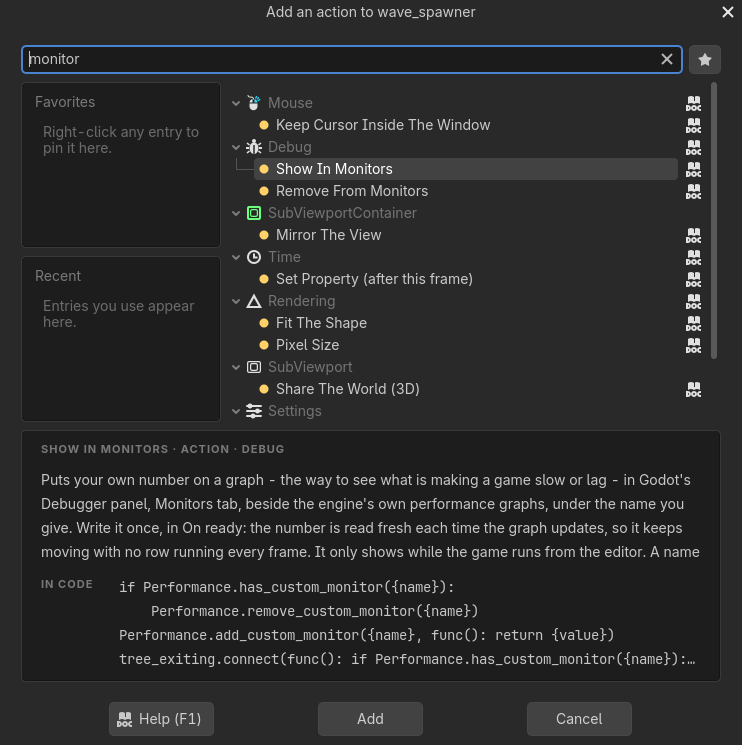
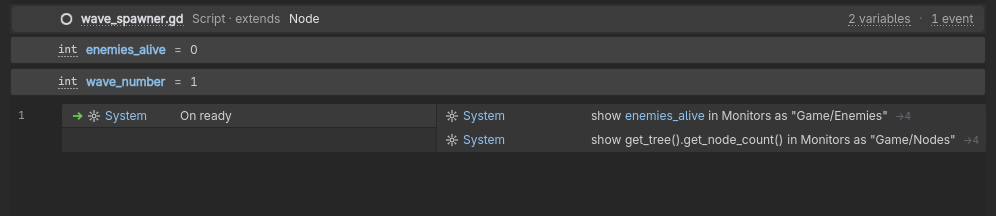
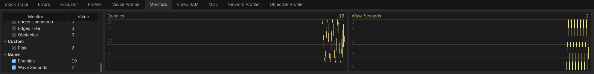

# Is my game slow? Measure it, then fix it

A game that stutters, drops frames or heats up a phone is slow in one particular place, and the
fix for that place is rarely the one you would have guessed. This guide walks the order that saves
time: notice the problem, ask Godot's own tools what is happening, time your own logic, watch the
number that matters while you play, let the Project Doctor look for the usual causes, and only then
change something - with the shipped tool that fits. It is for someone new to Godot, someone who
arrives from another event-sheet editor, and someone who reads the GDScript the sheet writes.

Nothing here makes a game faster by itself. It makes the slow part visible, which is most of the work.

## Table of Contents

1. [Tell whether there is a problem](#1-tell-whether-there-is-a-problem)
2. [Godot's own tools come first](#2-godots-own-tools-come-first)
3. [Time your own logic](#3-time-your-own-logic)
4. [Watch a number while you play](#4-watch-a-number-while-you-play)
5. [Let the Project Doctor look](#5-let-the-project-doctor-look)
6. [The usual fixes, and the tool for each](#6-the-usual-fixes-and-the-tool-for-each)
7. [Every row this guide uses](#7-every-row-this-guide-uses)
8. [Use cases](#8-use-cases)
9. [Other use cases](#other-use-cases)
10. [Tips and common mistakes](#tips-and-common-mistakes)

---

## 1. Tell whether there is a problem

"It feels slow" is not a measurement. Three rows turn the feeling into something you can act on, and
each of them needs an event that runs every frame (**On process**).

- **Frame Took Longer Than** (`Debug`) is true on a frame that took longer than the number of
  milliseconds you give it. 16.6 is one frame at 60 FPS. It catches a hitch as it happens, so the row
  under it can print the moment or mark it on screen.
- **FPS Below For** is true once the framerate has stayed under a floor for a whole stretch, such as
  under 45 for three seconds. One stuttery frame is not a performance problem; three seconds of them is.
- **On The Frame Running Long** is true on the ONE frame where a run of long frames reaches the length
  you name, and quiet after that. It is the moment a game decides to turn its own effects down. Its
  partner **On The Frame Recovered** is the moment it is safe to turn them back on. The gap between the
  two settings is what stops the game flicking its quality up and down on the boundary.

```
On process
  Frame Took Longer Than 20 ms
    -> Print "slow frame"
```

If none of them ever fires on the machine you care about, you may not have a problem. Test on the
weakest machine the game is meant to run on, with the whole scene in play, not an empty one.

## 2. Godot's own tools come first

Godot already draws graphs and tables for all of this, and they are better than anything a sheet
could add, so this plugin does not rebuild them. Run the game from the editor, then open the
**Debugger** panel at the bottom. Each tab answers one question:

| Tab | The question it answers | Use it when |
| --- | --- | --- |
| **Monitors** | How is this number changing over time? Frames per second, time spent in process and physics, memory, number of objects and nodes, draw calls. | You want the shape of the problem: is it steady, spiking, or climbing? |
| **Profiler** | Which function is costing the time? Every script function, with the time it took in total and per call. | The Monitors graph says the script side is slow and you need to know which function. |
| **Visual Profiler** | Is the time going to the processor or the graphics card, and in which part of drawing? A bar per frame, split into steps. | The game is slow but your scripts are not the heavy part. |
| **Video RAM**, **Misc** | What is in graphics memory, and what has the game got open. | A memory problem rather than a speed one. |

A sheet compiles to plain GDScript, so a row is just a function line to the Profiler. The function
names it shows are the ones you see in the compiled file; open the file's **Code** view to read
them. The sheet adds no layer between your logic and these tools.

The one thing Godot's tools cannot tell you is what YOUR logic means. They can say that `_process`
in `enemy.gd` took 6 ms. They cannot say that "spawn wave" took 6 ms, or graph "enemies alive" next
to the frame time. The next two sections are for that.

## 3. Time your own logic

Two rows make a stopwatch around the work you suspect: **Start Measuring** and **Stop Measuring**, both
with a name. Put them either side of the rows you want to time. Each time the stopwatch is stopped
the result is filed under its name, keeping the last reading, the average and the worst:

- **Last Measured (ms)**, **Average Measured (ms)** and **Peak Measured (ms)** read those back by name.
  The average is the number to quote when you claim a change helped; the peak is usually the run the
  player felt.
- **Log Measurements** prints every name with its last, average and peak in the Output panel, the
  report you paste into a bug or a devlog. **Clear Measurements** starts again from nothing.

```
On key pressed "Space"
  -> Start Measuring "spawn wave"
  -> (the rows that spawn the wave)
  -> Stop Measuring "spawn wave"
  -> Print Last Measured (ms) "spawn wave"
```

A measurement of a few runs is noise. Let the thing happen a hundred times, then read the average and
the peak. Measure one change at a time: change something, measure again with the same name, compare.

## 4. Watch a number while you play

A printed number scrolls away. A number on a graph keeps its history, which is what shows a slow climb
(something that leaks) or a periodic spike (something that runs once a second). Three ways to watch one.

### 4.1 In Godot's own Monitors tab

**Show In Monitors** puts a number of yours on the graph beside Godot's own, under a name you choose.
It is two fields: a **Name** and a **Number**.



A name with a slash files the graph under a heading: `Game/Enemies` is a graph called Enemies in a
group called Game. A name without a slash goes under a heading called Custom.



Two things make this row different from the others in this guide, and both follow from how Godot works.

**Write it once, in On ready.** The number is not sent to Godot every frame. Godot is handed the name and
a way to read the number, and asks for it each time the Monitors tab updates its graph. So the row is
written once and the graph keeps moving; a row in **On process** would add the graph again sixty times a second. (If
you do run it again, the old graph of that name is replaced, with no error.)

**Use a variable of the object, not a temporary one.** What the number reads is looked at again at every
update. A variable that belongs to this object, such as `enemies_alive`, is read fresh each time. A
temporary made inside the event is frozen at the value it had when the row ran.

The graph is taken away by itself when its object leaves the game, which is what keeps the Monitors tab
quiet when a level changes. (Godot does not do this for you: a graph whose object has gone prints an
error at every update for as long as the game runs.) **Remove From Monitors** takes one away sooner, **Is
In Monitors** asks whether a name is there, and **Custom Monitor Value** reads back the number a graph is
showing. Ask **Is In Monitors** first: asking for a name that is not there prints an error.

The graphs only exist while the game runs from the editor with the Debugger open. In an exported game
nothing reads them, so they cost nothing.



Godot writes the names with capital letters ("Game/Wave seconds" shows as Wave Seconds) and draws each graph only when you tick its box in the list on the left of the Monitors tab.

```gdscript
extends Node

func _ready() -> void:
	if Performance.has_custom_monitor("Game/Score"):
		Performance.remove_custom_monitor("Game/Score")
	Performance.add_custom_monitor("Game/Score", func(): return score)
	tree_exiting.connect(func(): if Performance.has_custom_monitor("Game/Score"): Performance.remove_custom_monitor("Game/Score"))
```

That is what **Show In Monitors** writes: Godot's own `Performance.add_custom_monitor`, guarded against
a name that is already taken, and cleaned up when the object leaves the tree. You can write the same by
hand in any script.

### 4.2 On the game itself: the Debug Overlay pack

The **Debug Overlay** pack paints a list of watched values on the running game, which is where the
Debugger panel cannot reach: a phone, a fullscreen window, a playtester's build. **Watch Value** shows
`name = value`, **Show Bar** draws a meter filled to a fraction, and **Toggle Overlay** (key F3 by default)
hides it. It draws only in debug builds.

### 4.3 As a record: trails and CSV

A **trail** is a named rolling history of values. **Remember In Trail** records one each time it runs, keeping
the last N; **Lowest In Trail**, **Highest In Trail**, **Average In Trail**, **Newest In Trail**,
**Trail Length** and **Trail Values** read it back. **Log Trail** prints it, and **Save Trail To CSV**
writes a two-column file you can open in a spreadsheet and plot. Use a trail when the bug lives in the two
seconds before the frame you are looking at.

## 5. Let the Project Doctor look

The Project Doctor has a **Performance** section. It reads every script in the project and looks for
the six usual ways a frame gets spent: a node looked up by path every frame when it never moves, a whole
group or child list scanned every frame, a distance computed only to be compared against a number, a
loop with hundreds of turns inside one frame, nodes made and freed every frame, and a label rewritten every
frame with the same words. Each finding says where, and offers the fix that is one click away. It
costs one read per script for a project with no per-frame work, and reports nothing at all.

It reads text, not a running game, so it finds the usual causes, not the cause. If the game is slow
and the Doctor is quiet, go back to sections 2 to 4 and measure.

## 6. The usual fixes, and the tool for each

Fix what the measurement named, and measure again afterwards.

| The measurement says | The usual cause | The shipped tool |
| --- | --- | --- |
| One frame is long, once a second or when something spawns | A lot of work done in one frame | **Time Slicer** pack: **Enqueue Group** or **Enqueue Items**, then do the work in **On Process Item**. It hands you items only as fast as its budget allows, and **On Drained** fires when the queue is empty. |
| You already have a For Each that hitches | The same, in a loop you wrote | Give the loop a frame-spread count or millisecond budget in its pick filter, or put **Begin Frame Budget** before it and **Await If Over Budget** inside it. |
| A long chain of work in one event | The same, written as steps | **Await Next Frame** lets the rest of the event run on the next frame. Use it in a one-shot event, never in an ungated **On process**. |
| Nodes in the Monitors tab keep climbing, or spawns hitch | Making and freeing many short-lived nodes | **Object Pool** pack: **Create Pool**, **Spawn**, **Despawn**. Most games do not need it: measure first. |
| Time goes to a search done every frame | Scanning a whole group, or asking for the same node by path | Count or call a group with **Count Nodes In Group** and **Call Method On Group**, ask less often (a **Timer**, five times a second is invisible), or keep the node in a variable. |
| Genuinely heavy calculation | Too heavy even to spread | **Run In Background** pack, which hands pure work to a worker thread. |
| Several effects at once drag the frame | Too much on screen | **On The Frame Running Long** to turn effects down, **On The Frame Recovered** to turn them up. |

The performance reference covers the Time Slicer, the budget rows and Run In Background in depth.
The Object Pooling guide covers when a pool is worth it and the traps of a node that lives more than once.

## 7. Every row this guide uses

All rows are in the picker; search for the name, or for `performance`, `slow` or `monitor`.

| Name | Where in the picker | What it does |
| --- | --- | --- |
| **Frame Took Longer Than** | Debug | True on a frame longer than your millisecond budget. |
| **FPS Below For** | Debug | True once the framerate stays under a floor for a stretch. |
| **On The Frame Running Long** | Debug | True once, when a run of long frames reaches your length. |
| **On The Frame Recovered** | Debug | True once, when calm frames follow a long run. |
| **Start Measuring**, **Stop Measuring** | Debug | A named stopwatch around the work you suspect. |
| **Last Measured (ms)**, **Average Measured (ms)**, **Peak Measured (ms)** | Debug | Read a stopwatch back. |
| **Log Measurements**, **Clear Measurements** | Debug | Print every stopwatch; start again. |
| **Show In Monitors** | Debug | Puts a number of yours on a graph in Godot's Monitors tab. |
| **Remove From Monitors** | Debug | Takes that graph away. |
| **Is In Monitors** | Debug | True while a graph by that name is there. |
| **Custom Monitor Value** | Debug | The number a graph shows now. |
| **Remember In Trail**, **Log Trail**, **Save Trail To CSV**, **Clear Trail** | Debug | A rolling history of values. |
| **Lowest In Trail**, **Highest In Trail**, **Average In Trail**, **Newest In Trail**, **Trail Length**, **Trail Values** | Debug | Read a trail back. |
| **Performance Monitor** | Utility: Debug | Godot's own reading (frames per second, process time, objects, draw calls) as a number. |
| **FPS** | Time | The current frames per second. |
| **Await Next Frame**, **Begin Frame Budget**, **Await If Over Budget** | Performance | Spread a loop across frames. |
| **Count Nodes In Group**, **Call Method On Group** | Groups | Ask or tell a whole group in one row. |
| **Watch Value**, **Show Bar**, **Toggle Overlay** | Debug Overlay pack | A heads-up list on the running game. |
| **Enqueue Item**, **Enqueue Items**, **Enqueue Group**, **On Process Item**, **On Drained**, **Set Frame Budget** | Time Slicer pack | Drain a queue within a per-frame budget. |
| **Create Pool**, **Spawn**, **Despawn** | Object Pool pack | Reuse nodes instead of freeing them. |

## 8. Use cases

1. **Is it slow at all?** On process, **Frame Took Longer Than** 20 ms, Print "slow frame". Play a
   normal level; if the Output stays empty, stop here.
2. **Catch a hitch the moment it happens.** Same event, but the action is **Mark Point** (Debug Overlay pack) at
   the player, so you see where on the map the frame went long.
3. **Only worry about a real drop.** On process, **FPS Below For** 45 for 3 seconds, Print
   "framerate dropped". A single stutter will not fire it.
4. **See the shape of the framerate.** Open Debugger > Monitors while you play and read the FPS and
   process-time graphs. A flat line with sharp teeth is a spike; a slope is a leak.
5. **Find which function is costing the time.** Debugger > Profiler, Start, play the slow part, Stop,
   and sort by total time. The top function is where to look, whichever sheet wrote it.
6. **Tell scripts from graphics.** If the Profiler's script time is small, open the Visual Profiler: the
   split between CPU and GPU says which side to work on.
7. **Time one piece of your own logic.** **Start Measuring** "spawn wave", the spawning rows,
   **Stop Measuring** "spawn wave". Read **Average Measured (ms)** after a dozen waves.
8. **Prove a change helped.** Measure with the same name before and after; compare the two averages
   and the two peaks, not one lucky run.
9. **Report it.** **Log Measurements** on a key, and paste the printed lines into the bug.
10. **Graph how many enemies are alive.** On ready, **Show In Monitors** `"Game/Enemies"` with
    `get_tree().get_node_count_in_group("enemies")`. Run the game with Debugger > Monitors open and
    watch the graph rise as waves arrive.
11. **Graph the cost of your own work.** On ready, **Show In Monitors** `"Game/Spawn ms"` with
    **Last Measured (ms)** `"spawn wave"`: the stopwatch from use case 7 as a line over time.
12. **Watch a value that grows.** Show a variable such as `pending_orders` in the Monitors tab; a line that
    climbs and never falls is a leak you can now see.
13. **Show it on the game for a tester.** **Watch Value** `fps` in the Debug Overlay pack: a tester's
    build has no Debugger panel.
14. **Keep a record of the two seconds before a bug.** **Remember In Trail** `"speed"` every frame, keep 120,
    and **Save Trail To CSV** when the bug is hit.
15. **Turn effects down when the game struggles.** **On The Frame Running Long** 20 ms for 30 frames,
    turn particles off; **On The Frame Recovered** under 12 ms for 300 frames, turn them back on.
16. **Spread a wave over frames.** **Enqueue Group** `"spawn_points"`; in **On Process Item**, spawn one;
    nothing else changes, and the hitch is gone.
17. **Stop asking every frame.** An event that counts a group every frame: move it to a **Timer** that
    fires five times a second.

## Other use cases

- **Mobile battery.** Lower a heavy effect when **FPS Below For** says the device is struggling.
- **Level streaming.** **Enqueue Items** for the tiles of a new room so loading never freezes the game.
- **A leaderboard of your own functions.** One stopwatch per system, **Log Measurements** at the end of a run.
- **Comparing two ways.** Measure both under the same name pattern with the same input and keep the cheaper.
- **A soak test.** Leave the game running with **Show In Monitors** on the node count and see whether it ever stops climbing.

## Tips and common mistakes

- **Measure before you fix.** A change made to the wrong place makes the code harder to read and the game
  no faster. Use sections 1 to 4 to find the place first.
- **Measure in a normal run.** The editor's own Debugger slows a game a little, and a debug build is
  slower than an exported one. Compare like with like.
- **Show In Monitors belongs in On ready.** In On process it replaces the graph sixty times a second and
  the line never draws.
- **Graph a number.** Show a count, a length or a time; for a text or a position, take its length or one
  component.
- **Give each object its own graph name.** Two objects showing the same name replace one another, and
  the first to leave takes the graph with it.
- **The graphs live only in the editor's Debugger.** Use the Debug Overlay pack where there is no Debugger.
- **A stopwatch name is free text.** A typo makes a second, silent stopwatch: copy the name.
- **A budgeted loop needs a per-frame trigger.** Under a one-shot trigger it only runs its first slice.
- **Do not pool by default.** A pool has a price; see the Object Pooling guide before you build one.
