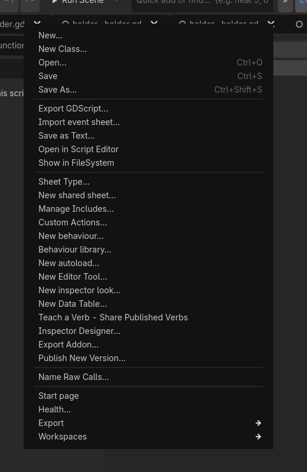
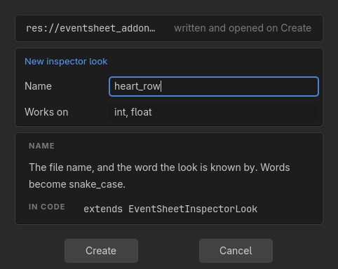
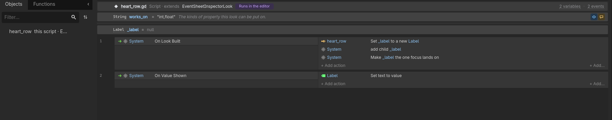
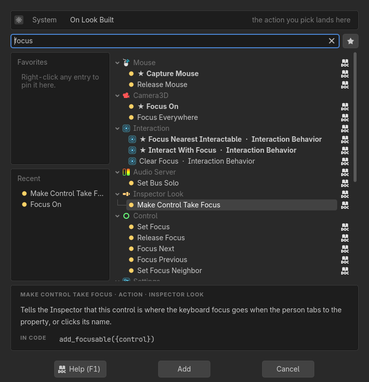
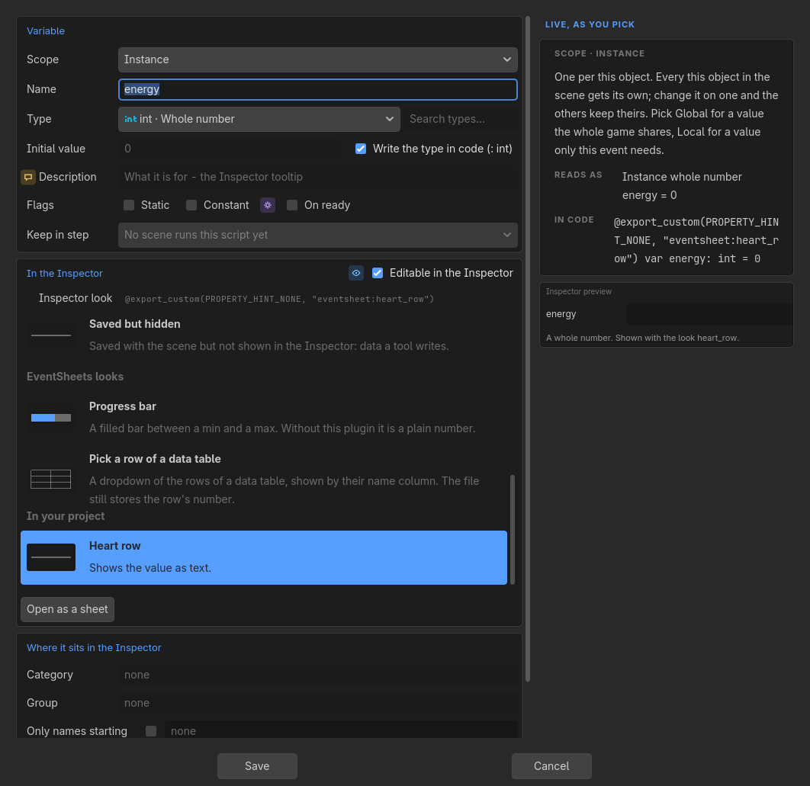
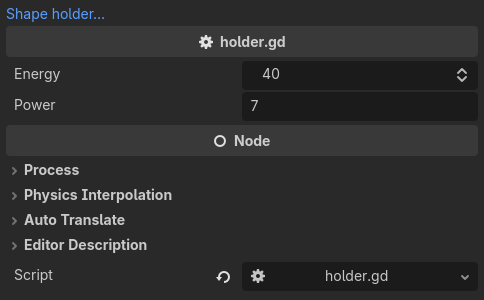
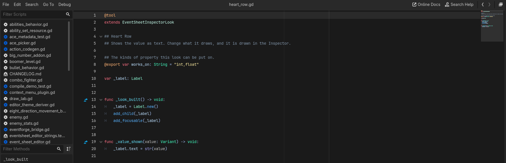
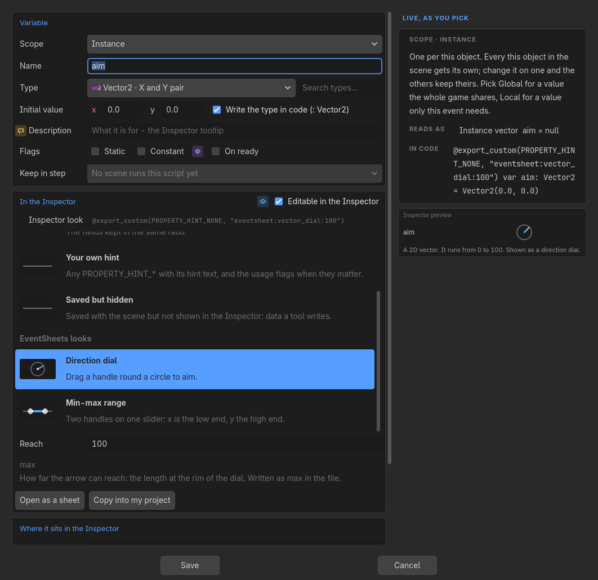

# Make Your Own Inspector Look

A **look** is how one property is drawn in Godot's Inspector in the place of its plain field: a progress bar, a row of stars, a dial. The looks that ship with this plugin (the progress bar is the first) are ordinary scripts, and so is every look you add. **A look is one script file.** Put it in `res://eventsheet_addons/looks/` and it is a look: nothing is registered, and the Variable window lists it the next time it opens.

A look is a script that extends `EventSheetInspectorLook`, which is a thin layer over Godot's own `EditorProperty`. Everything `EditorProperty` gives you (`add_focusable`, `set_bottom_editor`, `emit_changed`, `_set_read_only`) is still yours. The point of the base class is only to make the common case short.

You do not have to write that file by hand. A look is a plain script, so it is also an event sheet: **New inspector look** starts one, and the rows you add are the same code the Inspector runs. Both roads are below, and they end in the same file.

## Table of Contents

1. [Scenarios Where This Excels](#1-scenarios-where-this-excels)
2. [Core Concepts](#2-core-concepts)
3. [Make a look from the sheet alone](#3-make-a-look-from-the-sheet-alone)
4. [Getting Started: a star rating in one file](#4-getting-started-a-star-rating-in-one-file)
5. [What the editor reads from the file](#5-what-the-editor-reads-from-the-file)
6. [The functions you can write](#6-the-functions-you-can-write)
7. [What a look writes into the script](#7-what-a-look-writes-into-the-script)
8. [Opening a look as an event sheet](#8-opening-a-look-as-an-event-sheet)
9. [Use Cases](#9-use-cases)
10. [Tips and Common Mistakes](#10-tips-and-common-mistakes)

---

## 1. Scenarios Where This Excels

- **A control your game's data deserves.** A `rating` is five stars, a `volume` is a bar, a `facing` is four arrows. The designer sets it by looking at it.
- **One look for many scripts.** A look is not tied to one variable: any int property can wear the star rating, and each says how many stars it wants.
- **A control a team shares.** The file is plain text in the project, so version control carries it and a teammate who does not open the event sheet still gets the control.
- **Starting from a shipped look.** Copy the shipped file into your looks folder, give it a new name, change what it draws.
- **Learning Godot's editor classes.** The file is the same `EditorProperty` code the engine documents, with the plumbing taken off.

## 2. Core Concepts

**The file name is the look's name.** `star_rating.gd` is the look `star_rating`, and the word in the marker the script carries: `@export_custom(PROPERTY_HINT_NONE, "eventsheet:star_rating:5")`. There is no `class_name` in a look file, on purpose: two copies of one look would otherwise be a duplicate class.

**The editor reads the file's text, it does not run it.** The name, hover, the types the look works on and the questions it asks are all read from the text, so the Variable window can list a look without building a control. The control is built only when the Inspector draws a property that wears the look.

**A look runs in the editor, so its file starts with `@tool`.** Godot has to run the script to draw the control. It does nothing in a running game: the marker is only a hint string, and without this plugin (or in an exported game) the property is a plain field. Because a look extends an editor class, leave `eventsheet_addons/looks/` out of an export.

**Your questions become the marker.** Each exported variable of the look (except `works_on`) is one question the Variable window asks, and one value in the marker, in file order.

## 3. Make a look from the sheet alone

This road needs no editor code. You will make a look called `heart_row`, give a variable that look, and see Godot's Inspector draw it.

**1. Start the look.** Open the **Sheet** menu and choose **New inspector look...**



**2. Name it and say what it works on.** Type the name (words become `snake_case`, so `Heart row` is `heart_row`) and the kinds of property it can be put on, separated by commas (`int, float`). Leave **Works on** empty for any kind. Create is greyed, with a sentence under the name, when something is wrong: a name already taken, a type nobody knows.



**3. It opens as a sheet.** Create writes `res://eventsheet_addons/looks/heart_row.gd` and opens it. A small working look is already there: **On Look Built** makes a label, **On Value Shown** puts the value in it. Those two events are the two functions the Inspector calls on a look. A third, **On Value Changed From Outside**, is for undo or a script moving the value, and you add it the way you add any event.



**4. Add a row.** Select an event and choose **Add action**. The picker has an **Inspector Look** shelf, and only on this sheet: **Set the field's value** (write a new value, one undo step), **Make this control the one focus lands on**, and the expression **the field's value**. Five more rows build the parts a look is made of the way Godot's own fields are: **a themed panel**, **a message line**, **a number field**, **a joined strip** of toggle buttons, and **Put this under the first row** for a wide part (a dial, a picture) that sits on a line of its own under the name. Everything else in the picker works as it always does.



**5. Save.** The sheet writes the file.

**6. Give a variable the look.** Open the sheet of a script, add an `int` variable, and pick **Heart row** in the list under **Inspector look**. Each look in that list has a small picture, its name and one grey sentence, under the headings Godot's own, EventSheets looks and In your project. A look that asks questions shows them here, one field each, labelled by the first `##` line above the question's variable in the look's file.



**7. See it.** Save the script, select a node that has it, and Godot's own Inspector draws the property with your look.



**8. It is plain GDScript.** Open `heart_row.gd` in Godot's script editor and it is the ordinary code you would have typed:





Two doors sit in the Variable window under a look that is a file. **Open as a sheet** reads its file as a sheet (a look that ships with the plugin opens read-only). **Copy into my project** copies a shipped look's file into `res://eventsheet_addons/looks/`, where your copy is the one the Inspector uses and is yours to change; it never overwrites a file that is already there.

## 4. Getting Started: a star rating in one file

Create `res://eventsheet_addons/looks/star_rating.gd`:

```gdscript
@tool
extends EventSheetInspectorLook

## Star rating
## A row of stars. Click one to set the value.

## The kinds of property this look can be put on.
@export var works_on: String = "int"
## How many stars the row shows.
@export var count: int = 5

var _stars: Array[Button] = []


func _look_built() -> void:
	var row: HBoxContainer = HBoxContainer.new()
	for number: int in range(1, count + 1):
		var star: Button = Button.new()
		star.flat = true
		star.pressed.connect(_pick.bind(number))
		row.add_child(star)
		_stars.append(star)
	add_child(row)
	add_focusable(_stars[0])


func _value_shown(value: Variant) -> void:
	for index: int in range(_stars.size()):
		_stars[index].text = "★" if index < int(value) else "☆"


func _pick(number: int) -> void:
	set_field_value(number)
```

Now open the Variable window on an int variable. the list under **Inspector look** shows **Star rating** under In your project, and one question under the list: `count`. Pick it, leave 5, and the variable is written as:

```gdscript
@export_custom(PROPERTY_HINT_NONE, "eventsheet:star_rating:5") var rating: int = 3
```

Select a node that has that script. The Inspector draws five stars, three of them filled. Click the fourth and the property becomes 4, as one undo step.

## 5. What the editor reads from the file

| In the file | Used as |
|---|---|
| The first `##` line after `extends` | The look's name in the list |
| The `##` lines after it | The look's hover |
| `@export var works_on: String = "int,float"` | The types it can be put on. Empty means any type. A class name (`Texture2D`, `Curve`) works for a resource slot |
| Every other `@export var` | A question, asked in file order, written into the marker in that order |
| The first `##` line above a question | The question's label in the Variable window. With no `##` line the label is the name as written |
| The `##` lines after it | The question's hint (the grey example in a text box), and its hover beside the name |
| `@export_enum("a", "b") var mode: String` | A question with a dropdown |
| `@export var outlined: bool = true` | A question with a tick box |
| `const MARKER_TEMPLATE := "kinds={kinds},store={store}"` | A look whose values must share one segment (`kinds=px|world,store=world`) |
| `const PREVIEW_SENTENCE := "Shown as a star rating."` | The sentence the Designer's preview card says under a variable wearing the look. Without it the card says "Shown with the look star_rating." |
| `const ALSO_DRAWS_ON := "int"` | Types the look draws when a script's marker already asks for it, without offering the look for them in the Variable window |

A value that holds a colon, a quote or a line break cannot ride a marker; the look then writes nothing and the variable stays a plain field. A name that is already one of Godot's own (`name`, `size`, `visible`) cannot be a question, because the look is a node.

## 6. The functions you can write

You write these. You never override `_update_property`: the base needs it to keep the value in step.

| Function | Runs | Use it to |
|---|---|---|
| `_can_draw()` | Once, after the questions are answered and before anything is built | Say no when the values a marker carried make no sense (a table that is not a variable name). The Inspector then keeps Godot's plain field |
| `_look_built()` | Once, when the control is first needed, with the questions already answered | Make the control, connect signals, `add_child` |
| `_value_shown(value)` | On every refresh | Draw this value. Do not call `set_field_value` here |
| `_value_changed_from_outside(value)` | Before `_value_shown`, when the value moved without this look (undo, a script, another editor) | Stop an animation or reset a drag |

Two more let a look put whole rows beside its field, each in the value column: `_rows_above_field()` returns the controls drawn above it (a control may carry the meta `row_label` to give its row a label, as Godot's own rows have) and `_rows_under_field()` the ones drawn directly under it, as a note is. Both are asked once, right after the look is built, so keep a reference to anything that must follow the value. The weighted table's odds bar and roll button, and the tag look's amber line, are made this way.

And these are ready to call:

| Call | What it does |
|---|---|
| `set_field_value(value)` | Writes a new value. The Inspector owns undo |
| `field_value()` | The property's value right now |
| `field_name()`, `field_type()`, `field_object()` | The property's name, its Variant type and the object it is on |
| `is_field_read_only()` | True when the Inspector has the property locked |
| `marker_args` | What the marker carried after the look's name, split on `:` exactly as written. For a marker with a grammar of its own (a list, then optional tails); most looks read their exported variables instead |

## 7. What a look writes into the script

The marker is `eventsheet:<file name>`, then each answer after a colon: `eventsheet:progress_bar:0:100` for the shipped progress bar with a min of 0 and a max of 100. The script is plain GDScript: the marker is only a hint string, so it compiles, exports and runs without any plugin.

**Your look keeps the marker; three shipped looks do not.** The progress bar, the toggle buttons and the number with its unit say their data in a Godot annotation of their own (`@export_range`, `@export_enum`), so the plugin writes that line and names the look on a `# @inspector_look <word>` comment above it - without the plugin the property is then Godot's own control with the same limits. A look you add holds data Godot has no hint for, so it is written as the `eventsheet:` marker above and shows as a plain field without the plugin. Both spellings stay readable for good, and a script written either way saves back as it was.

The looks that ship are files too, in the plugin's own `looks` folder, and they are the best examples to read: `progress_bar.gd` (two numbers), `swatch_row.gd` (no questions at all, a widget wrapped as it is), `table_row.gd` (two names, and `_can_draw`), `unit.gd` (one question that holds a whole spec), `toggle_row.gd` (reads `marker_args` for its tails) and `table.gd` (a grid of cells). Each wraps a drawing widget the plugin already had, so the Inspector draws the same pixels as before the look became a file. The markers they write are the ones scripts already carry: a marker written before looks were files opens, saves back byte for byte and draws exactly as it did.

Opening a script that carries a marker for a look the project does not have still works. The sheet keeps the marker, saving writes it back byte for byte, and the Variable window offers it as "Look not installed" rather than dropping it.

**Save and show.** A choice made in the Inspector Designer is saved to the script at once and Godot is told the file changed, so the selected node's Inspector redraws with the new look without reselecting it.

## 8. Opening a look as an event sheet

A look is a plain script, so it opens as an event sheet like any other: its exported variables are variable rows, and each function is an event. Saving untouched writes the file back byte for byte. Edit the rows, save, and the look changes.

On a sheet whose script extends `EventSheetInspectorLook`, the three functions the Inspector calls read in the Inspector's own words, and the picker offers the rows that go with them:

| Function in the file | Reads as | Called when |
|---|---|---|
| `func _look_built() -> void:` | On look built | Godot's Inspector first needs the look for a property |
| `func _value_shown(value: Variant) -> void:` | On value shown | The Inspector refreshes the property: first drawn, after an edit, after undo |
| `func _value_changed_from_outside(value: Variant) -> void:` | On value changed from outside | The value moved without this look moving it, just before On value shown |

| Call in the file | Reads as |
|---|---|
| `set_field_value(value)` | Set the field's value to value |
| `add_focusable(control)` | Make control the one focus lands on |
| `field_value()` | the field's value |
| `themed_panel()` | a themed panel |
| `message_line(text)` | a line saying text |
| `number_field(label)` | a number field labelled label |
| `joined_strip(buttons)` | a joined strip of buttons |
| `add_under_field(first_row, under)` | Put under under first_row |

The same function names in a script that is not a look stay ordinary functions. The rows are on the **Inspector Look** shelf of the picker, and only a look sheet is offered them.

**Kept elsewhere.** A look file does not have to live in `res://eventsheet_addons/looks/`. Code that keeps its looks elsewhere (an addon, a shared folder) can add one with `EventSheets.register_inspector_look("res://my_addon/looks/star_rating.gd")`. It returns `true` when the file exists, is a `.gd` file and reads as a look, and `false` otherwise. The Variable window lists it after the project's own looks, and a file of the same name in the project's looks folder still wins.

## 9. Use Cases

1. A star rating for a review score.
2. A progress bar for health, loading or reputation.
3. A row of arrows for a four-way facing.
4. A battery icon that fills for a charge level.
5. A thermometer for a heat value.
6. A row of lock icons for how many keys are held.
7. A pill that is green, amber or red by range.
8. A countdown ring for a cooldown in seconds.
9. A dial for a volume knob.
10. A strip of coloured dots for a difficulty level.
11. A slider with ticks at each allowed value.
12. A row of heart icons for lives.
13. A small bar chart of five related numbers.
14. A badge that shows a number over an icon.
15. A texture slot with a larger thumbnail beside it.

Other use cases:

- **A look for a typed resource.** `works_on` names a class such as `Curve`, and the look draws a preview under the slot.
- **A look with a unit.** One question names the unit, and the control shows it beside the number.
- **A look that reads a sibling.** `field_object()` gives the whole object, so the look can read another property of it.
- **A look that edits a list.** `works_on` is `Array` and the control is a small editor for its entries.
- **A look for a project's own type.** A look for one custom resource class, shared by every script that holds it.

## 10. Tips and Common Mistakes

- **No `@tool`, no control.** The look is drawn in the editor, so the file needs `@tool`. Without it Godot cannot build the control.
- **A new look does not show.** Check the file is in `res://eventsheet_addons/looks/`, it has `extends EventSheetInspectorLook`, and its name is a valid identifier.
- **Do not add `class_name`.** The file name is the identity.
- **Questions only grow at the end.** Variables already written with the look carry the old argument list; a shorter list reads with defaults for the rest, so add new questions last, with a default that reproduces the old marker.
- **A look with the same name as a shipped one wins.** Your file in the project replaces the shipped file of that name.
- **The marker never changes.** A marker already in a script keeps meaning what it meant, so keep a look's name and its first questions stable once it is in use.
