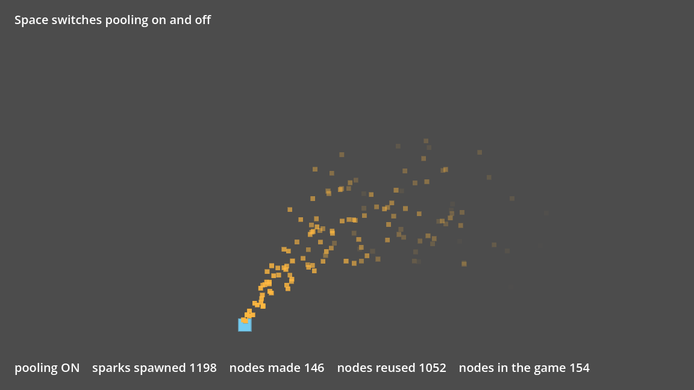
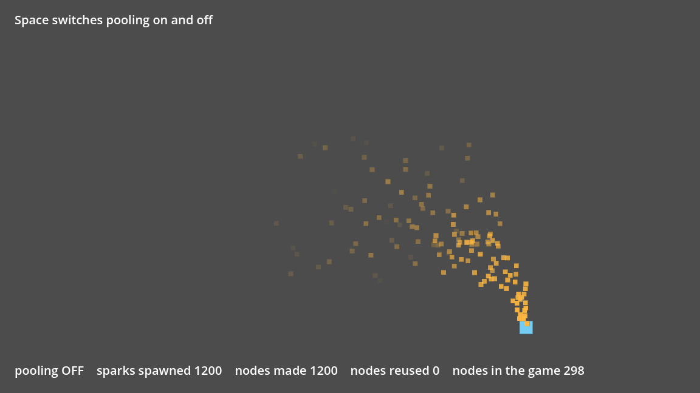
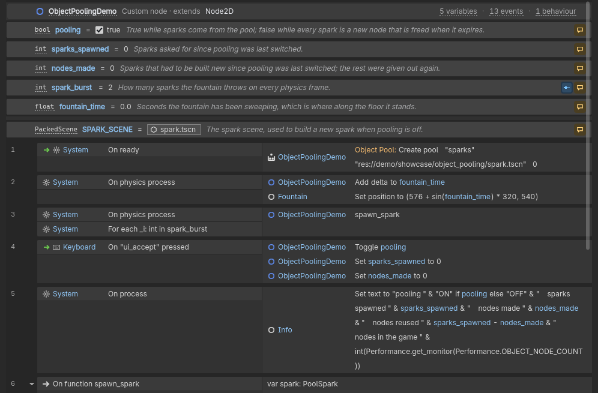
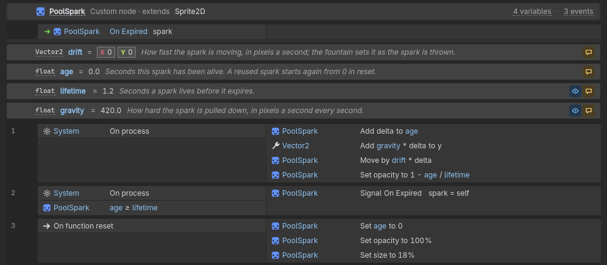

# Object pooling: reuse spawned nodes instead of freeing them

A game that throws sparks, fires bullets or drops coins makes a lot of small nodes and frees them a moment
later. **Pooling** keeps the nodes you have finished with on a shelf and hands the same ones out again, so
the game stops building and freeing them. This guide says when that is worth doing (not often), how to
turn it on for a spawn in a sheet, what the compiled GDScript looks like, and the traps that come with a
node that lives more than one life.

The showcase `demo/showcase/object_pooling/` is the worked example: open `object_pooling.gd` and `spark.gd`
as sheets and press Space in the running scene to switch pooling on and off.

## 1. What pooling is, and when you do NOT need it

Without a pool, every spawn is `instantiate()` plus `add_child()`, and every removal is `queue_free()`.
With a pool, a spawn takes a spare node off the shelf (or builds one only when the shelf is empty), and a
removal puts the node back on the shelf, hidden and switched off, to wait for its next life.

**Most small games do not need it.** Godot builds and frees a node cheaply. A bullet every quarter of a
second, a coin pickup, an enemy a second: none of it is worth a pool, and a pool has a price - every
node that lives again must be put back to a fresh state by hand (section 5). Reach for one when you can
point at the reason:

- something is spawned dozens of times a second, and lives about a second (sparks, bullets in a
  bullet-hell, hit effects, damage numbers);
- the scene you spawn is heavy to build (many children, a script that does work in `_ready`) and the
  game hitches the frame it appears;
- a mobile or web target where a burst of allocations is felt.

How to check before you build anything: run the game, open **Debugger > Monitors** and watch
**Object > Nodes** and the frame time while the spawning happens. If the line is flat and the frame time
is steady, you are done. The Project Doctor also says so itself: a row that makes a copy every frame
while another row frees one gets a finding offering the Object Pool.

## 2. See the difference first



A fountain throws about 120 sparks a second and each spark lives 1.2 seconds. Over ten seconds, measured
on the machine that took the pictures:

| | sparks spawned | nodes made | nodes in the game |
| --- | --- | --- | --- |
| pooling on | 1198 | 146 | 154 |
| pooling off | 1200 | 1200 | 298 |

With the pool, the count of nodes made stops climbing after the first second: about 146 sparks are alive
at once, and from then on every new spark is one that expired a moment ago. Without it, every spark is
a new node.



## 3. Turning it on for a spawn, step by step

The pool is the **Object Pool** pack. In your own project it is an autoload named `ObjectPool`
(Project Settings, Globals, Autoload), so its rows read `ObjectPool.spawn(...)`. Start from a spawn you
already have: an **Instantiate** row that makes a copy of a scene, and a **Destroy** row that frees it.

1. **Add the pack.** Add the Object Pool behaviour to the project from the behaviour library and
   register it as the autoload `ObjectPool`.
2. **Make the pool once.** In an **On ready** event add the action **Create pool**: a name (`sparks`), the
   scene path, and a prewarm count. Prewarm builds that many copies now, while nothing else is
   happening, so the first burst does not pay for them. Leave it at 0 to let the pool grow as needed,
   which is what the showcase does so that you can watch it.
3. **Take a copy from the pool.** Where the event used to instantiate the scene, use **Set variable**
   with the expression **Spawn** (`ObjectPool.spawn("sparks")`). It returns the node, already in the
   current scene, visible and running.
4. **Place it after.** Rows after the spawn set its position and velocity. A pooled copy is reset first
   (section 5) and your rows run after, so they win.
5. **Put it away instead of freeing it.** Replace **Destroy** with **Retire**. Retire asks the node where
   it came from: a copy the pool handed out goes back to the pool that made it, anything else is freed.
   That holds whether the pool is the autoload or a child node of your scene, and a scene with several
   pools gets each node back to its own. If you call the pool directly, the verb is **Despawn**. Both wait for the end of the frame, so they are safe
   inside a collision handler.
6. **Reset what a second life must not inherit.** Write a `reset` function on the pooled scene's script.
   The pool calls it on every spawn.



The pool is a named shelf, so one game can have several: `sparks`, `bullets`, `labels`. Despawn All hands
every copy of one back at once (a level restart), and Clear Pool frees them all and removes the pool.

## 4. What the compiled GDScript looks like

Nothing here needs the plugin to run. The sheet compiles to the lines you would write:

```gdscript
func _ready() -> void:
	ObjectPool.create_pool("sparks", "res://spark.tscn", 0)

func spawn_spark() -> void:
	var spark: PoolSpark = ObjectPool.spawn("sparks") as PoolSpark
	spark.position = $Fountain.position
	spark.drift = Vector2(randf_range(-140.0, 140.0), randf_range(-520.0, -300.0))
	if not spark.expired.is_connected(retire_spark):
		spark.expired.connect(retire_spark)
```

(The showcase writes `$ObjectPool` instead of `ObjectPool`, because it carries the pack as a child node
rather than asking you to change Project Settings.) It ends a spark's life with Retire, which works the same either way. The pack itself is a plain script, `object_pool_addon.gd`,
and it keeps one dictionary: pool name to `{scene, free, active}`.

If you wrote a pool by hand, it would be this, and the pack does the same plus the bookkeeping:

```gdscript
var _free: Array[Node] = []

func take(scene: PackedScene) -> Node:
	var node: Node = _free.pop_back() if not _free.is_empty() else scene.instantiate()
	node.get_parent().remove_child(node) if node.get_parent() else null
	add_child(node)
	node.process_mode = Node.PROCESS_MODE_INHERIT
	node.show()
	if node.has_method(&"reset"):
		node.reset()
	return node

func give_back(node: Node) -> void:
	remove_child(node)
	node.hide()
	node.process_mode = Node.PROCESS_MODE_DISABLED
	_free.append(node)
```

What the pack adds to that: parking a node under the pool with processing, physics processing and
process mode switched off (and remembering what they were, so a node whose own script had put its tick
to sleep wakes still asleep); clearing the node's `owner` meta so a reused bullet is never credited to
whoever fired the last one; booking the hand-back for the end of the frame; and refusing to put a node
on the shelf twice.

## 5. The traps

A reused node is the same node. Everything it was doing is still true.



- **It keeps its old state.** Velocity, health, a fade that left `modulate.a` at 0, a scale a hit
  animation shrank, a variable that counted up: all still there. Put them back in a function called
  `reset`, which the pool calls on every spawn, before the rows that follow the spawn. In the showcase,
  `reset` in `spark.gd` sets `age` to 0, `modulate.a` to 1 and the scale back, and nothing else, because
  the fountain sets the velocity every time. A sheet that uses **Only once per node** can clear that memory
  with **Forget once for** inside `reset`.
- **Signals are connected twice.** A connection made on one life is still there on the next. Connecting
  again on every spawn raises "already connected", or fires the handler twice. Connect once: guard
  with `is_connected` as the showcase does, or connect where the node is first built.
- **A timer or a tween you started is not cancelled by putting the node away.** A `create_timer` is owned by
  the scene tree and will still fire, possibly into the node's next life: **Retire after seconds** says this on
  its own description. Keep a tween in a variable and `kill()` it in `reset`. For a node that can be
  retired early, do not use a timed retire; end its life from the node itself.
- **Do not free a pooled node yourself.** `queue_free()` on a node the pool owns leaves it on the pool's
  list, and the next spawn hands out a freed object. Retire or Despawn it; use Clear Pool to free the lot.
  A scene you spawn without the pool is freed as before, which is why Retire is safe to use everywhere.
- **Reparenting inside a physics callback.** Taking a node back reparents it. Godot prints an error when
  a 2D physics body is reparented while the physics server is busy, which is the whole of a collision
  handler. Despawn and Retire book the move for the end of the frame, so call them from the handler
  without a worry. For the other direction use **Spawn safely** inside a callback.
- **A parked node is off.** It is hidden, takes no part in physics and does not process. Do not look for
  it with a group query expecting it to move; it is also still in its groups, so a loop over a group sees
  it. If a loop must only see live copies, check `visible`, or keep your own list.

## 6. How to tell it is working

- The pool says so: **Pool size** (every copy it has made), **Active count** (in use) and **Free count**
  (on the shelf) are expressions. Put them in a label as the showcase does. Pool size should climb and
  then stop; if it climbs for ever, copies are not coming back.
- Godot says so: **Debugger > Monitors > Object > Nodes** flattens out instead of sawing up and down.
- The two counters in the showcase, nodes made and nodes reused, are the same numbers made visible.
- If the numbers climb with pooling on, nothing is retiring the copies: check the row that ends a life
  actually runs, and that it hands the node back instead of calling Destroy.

## 7. How it maps to what you would write by hand

| In the sheet | In GDScript you would write |
| --- | --- |
| Create pool "sparks", scene, 32 | a `_free` array, filled with `scene.instantiate()` in a loop |
| Spawn "sparks" | `_free.pop_back()` or `instantiate()`, then `add_child()` and `show()` |
| Retire / Despawn | `remove_child()`, `hide()`, process mode disabled, `_free.append()` |
| `reset` function | the same method name; the pool calls it with `has_method` |
| Free count / Active count / Pool size | `_free.size()`, `_active.size()`, the sum |
| Despawn All | a loop that gives back everything in `_active` |
| Clear pool | `queue_free()` on every node in both lists |

## Other use cases

- **Floating damage numbers.** A pool of Labels: Spawn one, set its text and position, tween it up, and
  Retire it when the tween finishes. Kill the tween in `reset`.
- **Audio one-shots.** A pool of AudioStreamPlayers, so overlapping sounds each get a player without
  building one per sound.
- **Enemy waves.** Spawn ten from the `enemies` pool when a wave starts; Despawn All at the next
  level so nothing from the old wave is left.
- **Pickups in an endless runner.** Coins that scroll past are retired and come back ahead.
- **Pooled list rows.** A long scrolling list that draws only the rows on screen, reusing the same
  few row nodes as it scrolls.
