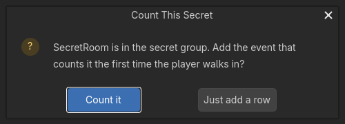

# Secrets and the End-of-Level Screen

A shooter counts three things while you play - how many enemies fell, how many secrets you found,
and how long it took - and shows all three the moment the level ends. This page is the two halves of
that: putting a room in the `secret` group so the sheet offers to count it, and the starter that puts the tally
on screen.

## Put a room in the secret group

An area is the shape a secret room is made of: a trigger volume you walk into. Select the node
in the Scene dock, open the Node dock, Groups, and add it to the group `secret`. That is Godot's own
group, saved in the scene file with the node, so the scene already says which rooms are secrets and
the sheet reads it from there. Nothing is stored by the plugin and the GDScript the sheet compiles to
does not change.

## Drop it on the canvas and the counter is offered

Drag an object in the `secret` group onto the canvas the way you would any other, and instead of going straight to
the picker the sheet asks first:

- **Count it** adds one event: the object's own walked-into trigger with the shipped **Mark Secret
  Found** row already in the action lane, naming the object as the secret. If the sheet has no
  `secrets_found` list yet, the same step declares it. One undo step for the lot.
- **Just add a row** (or Escape, or closing the dialog) does exactly what dropping an object has
  always done - it opens the picker scoped to that object. Nothing is written.

Mark Secret Found records a secret the first time and never again, so walking back through the room
does not count it twice. Read the running total anywhere with the **Secrets Found** expression.

## The end-of-level screen

**New Sheet ▾ ▸ Level Stats Screen** is the other half. It is a `Control` script you attach to your
UI root, and it does four things:

1. Counts `level_seconds` up every physics tick while `level_over` is off.
2. When you turn `level_over` on, flips to the panel named `StatsScreen` and writes the numbers
   into named labels - `KillsValue`, `SecretsValue` and `TimeValue` - and fills the `SecretsBar`.
3. Shows your time against the exported `par_seconds`, as `01:23 of 03:00`.
4. Answers a button named `ContinueButton`, resets the tally and flips back to `HudScreen`.

Every one of those numbers reaches the screen through the **HUD Kit** behaviour, which you drop
under the same UI root. HUD Kit drives named descendants - Switch Screen, Set Text, Set Bar - and
wires every descendant Button into one On Button Pressed trigger, so the whole screen is named nodes
and not one connected signal.

Two knobs are yours in the Inspector: `secrets_total` (how many the level hides) and `par_seconds`
(the time to beat). The counters themselves are plain variables, so the row that kills an enemy just
adds 1 to `kills`, and the secret areas fill `secrets_found` through the offer above.

## Ammo as a table

The **Boomer Arsenal** starter that feeds this screen keeps its ammo as a table rather than a
dictionary keyed by weapon name: an exported `Array` of records, one per weapon, with a `weapon`
column and a `rounds` column. The firing row finds the right record with the shipped **Row Where**
expression and spends a round on it. Row Where hands back the record itself rather than a copy, so
spending writes straight back into the table.

Adding a fourth weapon is therefore adding a fourth record - no second place to keep in step - and
every other table word (Column Of Table, and the loop rows) reads the same shape.

## Slowing down while you shoot

The FPS Controller behaviour has a matching row: **Set Move Speed While Firing**. Drop it on your
weapon's fired trigger with a speed and a number of seconds, and the host walks at that speed for
that long after each shot, then eases straight back to normal. Sprint and crouch still multiply it,
and the ordinary Move Speed knob is untouched, so the slowdown is a window rather than a mode.
**Is Firing** is the matching condition, for a weapon-ready pose or a tighter camera while the
window is open.
