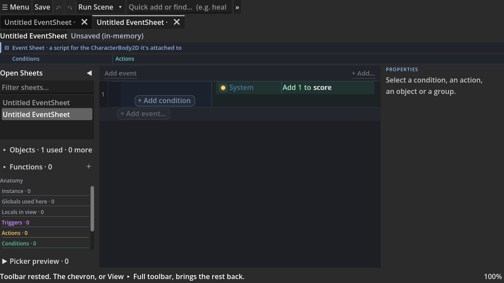
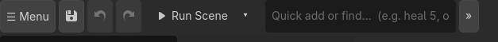
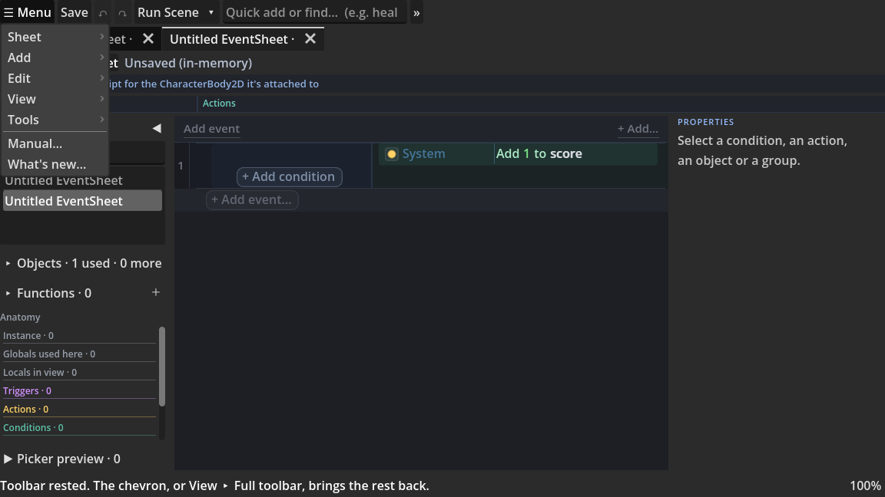
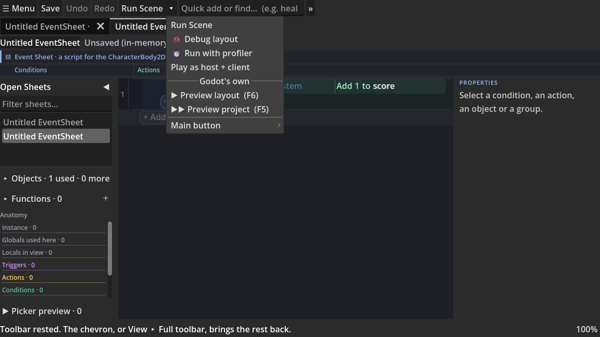
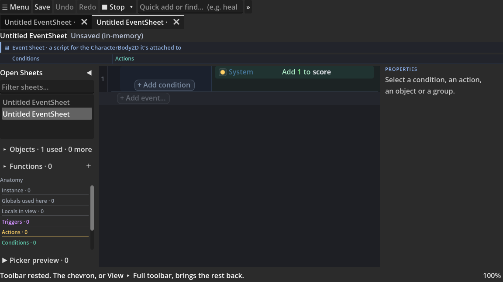
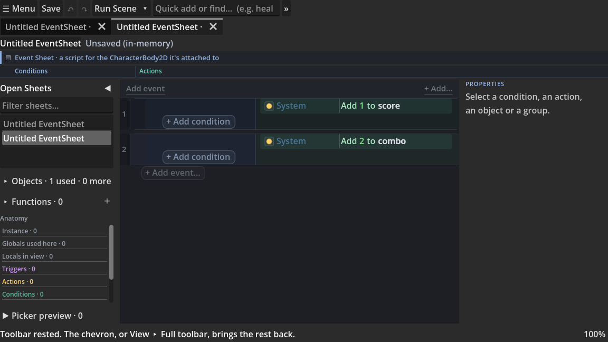
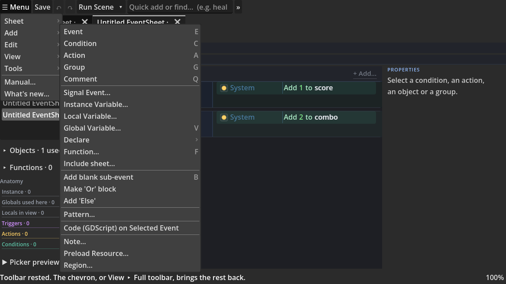
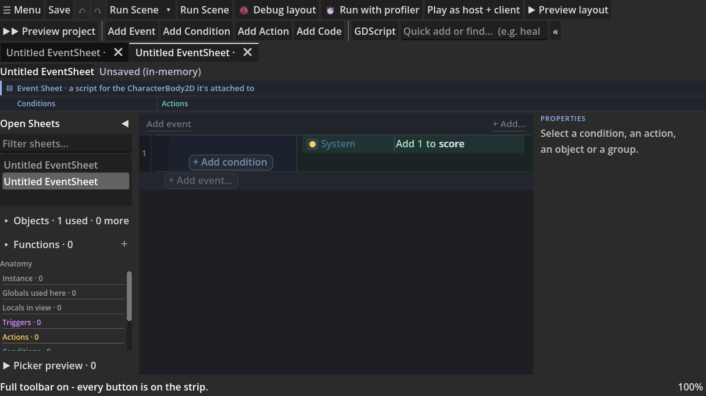
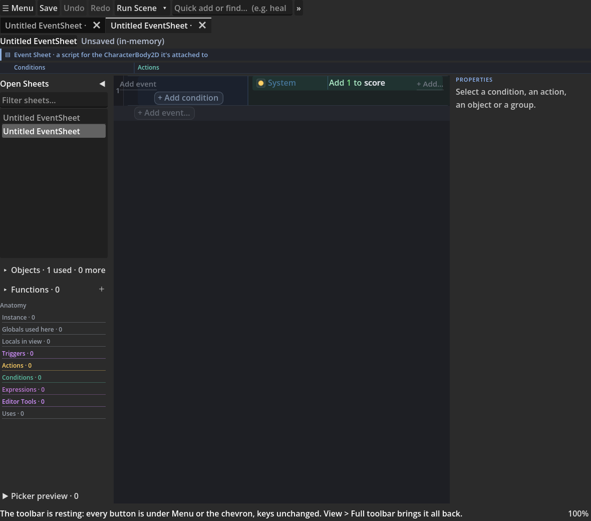

# The Toolbar: The Strip Across The Top

The event-sheet workspace has one strip along its top edge. At rest it carries **seven controls**,
in one row that never wraps (once a sheet is open, the Events / Code / Both switch joins the end of it):

Everything the editor can do is still one or two clicks from that row. This page says where each
thing is, what the play button does, why adding lives in the sheet rather than on the strip, and
what happened to every button that used to sit up there.

**The one promise this page is written around:** nothing the sheet can do was taken away. Every
command that had a place on the strip still has its id, its key and its home in a menu, and most of
them have a second door inside the sheet itself. A button you cannot see still answers to its key.
The one thing the strip no longer carries is a plain run of the scene or the project: those are
Godot's own Run Current Scene (`F6`) and Run Project (`F5`), in the bar at the top right of the editor.

## Contents

- [The resting seven](#the-resting-seven)
- [The Menu, group by group](#the-menu-group-by-group)
- [The play button, and which run it does](#the-play-button-and-which-run-it-does)
- [Adding lives in the sheet](#adding-lives-in-the-sheet)
- [The chevron, and View > Full toolbar](#the-chevron-and-view--full-toolbar)
- [Text labels: the strip as words](#text-labels-the-strip-as-words)
- [Where did it go? The whole table](#where-did-it-go-the-whole-table)
- [What Simple Mode actually does](#what-simple-mode-actually-does)
- [The one-time note](#the-one-time-note)
- [Why the strip is shaped this way](#why-the-strip-is-shaped-this-way)

## The resting seven

In reading order, left to right:

| # | Control | What it is | Key |
|---|---------|-----------|-----|
| 1 | **Menu** | One button holding five cascading submenus (Sheet, Add, Edit, View, Tools) plus the Manual and What's new |  |
| 2 | **Save** | An icon over the same save the key and Sheet > Save run. Compile-on-save keeps the generated script fresh | `Ctrl+S` |
| 3 | **Undo** | An icon over the dock's undo funnel. It greys out when the history is empty | `Ctrl+Z` |
| 4 | **Redo** | The same, the other way | `Ctrl+Shift+Z` |
| 5 | **The play button** | A face that performs the run this project chose, beside a narrow arrow holding the four ways to play | see below |
| 6 | **Quick add or find** | Type a whole row (`heal 5`, `boss fla 0.4`) and press Enter, or read the answers underneath: the states, rows, variables, functions, signals, modes and Doctor findings that match what you typed |  |
| 7 | **The chevron** | Expands the strip to every button it has, and back |  |

After the chevron, once a sheet is open, comes the **Events | Code | Both** switch: the rows, the GDScript
the file is, or both side by side. It is offered for every open sheet and is not part of the seven.

The three icons are the editor's own. Godot ships a `Redo` arrow but no `Undo` one, so the undo
arrow you see is the redo arrow mirrored - which is why the pair matches stroke for stroke and takes
its colour from whatever editor theme you are running. On a build with no icon to lend, the two wear
`↶` and `↷` instead.

Every key printed on the strip and in its menus is read from **your** bindings, not typed into the
editor's source. Rebind one in *Editor Settings > Shortcuts* and the tooltip and the menu item
say the new key with nothing else to change. The keys quoted on this page are the shipped defaults.

The row has to fit on one line in an editor of ordinary width, which is the whole point of it
resting: a suite test builds the strip, measures it, and fails if it outgrows its budget, so a
future pass that wants a resting control has to come here, re-measure, and say why. The headless
figure is smaller than the real strip, because a headless run has no editor theme to lend an icon,
so the icon faces wear a one-character glyph and the play face wears no icon at all. The number from
a real editor is the one that matters, and the preview harness
(`tools/render_toolbar_icons_preview.gd`) is what prints it.

## The Menu, group by group

One button, five groups, then two doors at its foot:

| Group | What lives there |
|-------|------------------|
| **Sheet** | The file's own life: New, Open, Save, Save As, Export GDScript, Import event sheet, Save as Text, Open in Script Editor, Show in FileSystem, Sheet Type, shared sheets, Manage Shared Sheets, the behaviour / Behaviour library / editor-tool / inspector-look / data-table starters, Teach a Verb, Inspector Designer, Export Addon, Publish New Version, Name Raw Calls, Health, Export (image / PDF / Markdown), Workspaces, Start page |
| **Add** | The whole authoring vocabulary: Event, Condition, Action, Section, Comment (each printing its key), signals, the three kinds of variable, the Declare submenu, functions, shared sheets, sub-events, Or, Else, Pattern, a code block, and one entry per registered custom block kind |
| **Edit** | Copy, Paste, Undo, Redo, Extract Selection to Shared Sheet, Find References, Generate from Description |
| **View** | Everything about what is on screen: the panels and lenses, zoom, split and detached views, Sheet theme, Load / Reload Theme, the Theme Editor, Preview In Language, Simple Mode, Familiar Words, the Outline, the Sheet Map, the Debugger, Saved Views, Arrange by, the collapse sweeps, Add toolbar, Full toolbar, Text labels |
| **Tools** | Debug and project work: breakpoints, Live Values, Event Trace, Bookmarks, Find in Project, Project View, Project Doctor, Check Sheet for Errors, the Studios, Lift Report and Workbench, Compare With, Loose Ends, Find Repeated Rows, Run Tests, the Replay Recorder, Welcome, the Tour, Words |
| _(foot)_ | **Manual...** and **What's new...**, the two doors a reader looks for by name rather than by group |

That is a long list behind one button, which is exactly why it is behind one button.

Three things about the cascade are worth knowing:

- **They are the same menus.** Sheet, Add, Edit, View and Tools used to be five separate buttons on
  the strip. Each one hangs under the Menu now carrying the same name, the same items in the same
  order, the same ids and the same handlers - held item by item by the suite rather than claimed
  here - so Godot's Command Palette, the keyboard dispatch and every test that addresses an item by
  number still finds it.
- **The ones that rebuild themselves still do.** Sheet theme, Arrange by, Saved Views,
  Workspaces and Export refill every time they open, so a theme dropped into the themes folder or a
  view saved a second ago is listed with no restart.
- **The Menu teaches its keys.** Sheet > Open / Save / Save As, Edit > Copy / Paste / Undo / Redo,
  Tools > Find in Project and the whole head of the Add menu print their bindings beside them, read
  from your Editor Settings shortcuts.

## The play button, and which run it does

Godot has no split-button control, so the play button is what Godot's own editor is in the same
situation: two adjacent controls in one frame. The **face** performs one run. The narrow arrow
beside it opens the four.

| Run | What it does | Key |
|-----|--------------|-----|
| **Run Scene** | Save, then play the scene that uses this sheet's script |  |
| **Debug scene** | The same run with the sheet's own debugger armed: Event Trace lights rows as they fire, Live Values streams the variables, breakpointed rows pause the game | unbound by default |
| **Run with profiler** | The same run with the costs lens on. Play, stop, and every row wears what one fire of it cost |  |
| **Play as host + client** | Two tagged copies of the game at once, for testing a networked one. It writes Godot's own Run Multiple Instances setting and says so |  |

Plain run-the-scene and run-the-project are not here: they are Godot's own Run Current Scene (`F6`)
and Run Project (`F5`) in the bar at the top right of the editor.

**Main button**, at the foot of the dropdown, is the same four as radio ticks. Picking one is what
the face does from then on, and the choice is remembered for this project, so a game you open next
week still opens wearing it. A project that never chose gets **Run Scene**.

While a game is running the face reads **Stop**, because the face is adopted by the same run controls that relabel every other run button
on the strip. There is one answer to what a run is called right now, not two.

All four are still plain buttons on the expanded strip, relabelled by the very same table.

## Adding lives in the sheet

The strip used to front four Add buttons. They are one chevron away now, because the strip was
never where a reader looks when they want another event: they look at the sheet. So the canvas
carries the two doors itself, pinned to its visible corners so scrolling a long sheet never takes
them away.

- **Add event** (top left) runs exactly what the `E` key runs.
- **+ Add...** (top right) opens exactly the menu a right-click on empty space opens.

Neither is a new power. Counting them, there are **seventeen** ways to put a row on a sheet, and the
strip is nowhere near the top of the list. Ranked by how often a working author actually reaches for
them:

| # | Door | Where it is |
|---|------|-------------|
| 1 | **The `E` / `C` / `A` keys** | Anywhere on the canvas. They open the Ghost Row: a small type-a-sentence popup at the selected row, not the full picker |
| 2 | **The lane's own add cell** | The muted "+ Add condition..." and "+ Add action..." cells at the end of a row's two lanes |
| 3 | **The trailing "+ Add event..." row** | At the foot of the sheet, and at the foot of a group |
| 4 | **Double-click empty space** | Opens the picker leading with object cards |
| 5 | **The "Add event" corner link** | Top left of the canvas, on every sheet |
| 6 | **The "+ Add..." corner link** | Top right of the canvas, on every sheet |
| 7 | **Right-click a lane** | The condition lane offers *Add Condition*, the action lane offers *Add Action* |
| 8 | **Right-click a row** | Insert > Event Above, Event Below, Section, Comment, Variable, Timeline, Script Block, Signal Handler, Enum - with *Make 'Or' block* and *Add 'Else'* beside it |
| 9 | **Right-click empty space** | New event, new condition, the three kinds of variable, an Inspector button, Insert snippet |
| 10 | **Quick add on the strip** | Type the whole row and press Enter |
| 11 | **Menu > Add** | The complete vocabulary, with the five reflexes at its head and their keys printed |
| 12 | **Menu > Add > Pattern...** | The Manual's Common Game Patterns page, each pattern drawn as its real rows with an Insert that lands them here |
| 13 | **The beginner Add toolbar** | Simple mode's own strip: eight buttons, Event through Function, each with its key on hover |
| 14 | **The expanded strip's four Add buttons** | Add Event, Add Condition, Add Action, Add Code |
| 15 | **Godot's Command Palette** (Ctrl+Shift+P) | Add Event / Condition / Action / Global Variable / Function, among everything else. Ctrl+P is a Go to window for a symbol, a sheet, a Manual page or a pasted error line |
| 16 | **Paste, and Duplicate** | `Ctrl+V` on copied rows, and duplicating a selection |
| 17 | **Drag onto the canvas** | An object from the Objects list starts an event on it; an Input Map action starts an On pressed event |

The whole Add menu also teaches the keys it stands for. Event (`E`), Condition (`C`), Action (`A`),
Section (`G`), Comment (`Q`), Global Variable (`V`) and Function (`F`) each print their binding beside
them, read from your Editor Settings shortcuts, so a rebind shows the new key with nothing to edit.

An eighteenth arrives if you turn it on: the optional **Ask box** (*Menu > View > Ask...*) answers in
rows you accept or discard, never in code you have to paste.

## The chevron, and View > Full toolbar

Press the chevron at the end of the row and the strip shows every button it has, in the order it
always had them:

Menu, Save, Undo, Redo, the play button, then Run Scene, Debug scene, Run with profiler, Play as
host + client, then Add Event, Add Condition, Add Action, Add Code,
then the GDScript panel toggle, Quick add, and the chevron pointing back the other way.

The chevron and **Menu > View > Full toolbar** are one choice shown twice: use either and the other
follows. The choice is remembered per project, and rest is the default for every project, including
one that already existed before the strip started resting. There was no resting/expanded choice to
migrate, so nothing was.

## Text labels: the strip as words

**Menu > View > Text labels** lays the resting strip out as words instead of icons: **Sheet**
(the same Menu, under its first group's name), **Save**, the Undo and Redo arrows, **Add Event** as
the one filled button, **Add Condition** and **Add Action** as plain words, the Quick add field
moved to the right edge to be the strip's **Find** (it still adds a row on Enter), and a
**Sentences** menu beside it. The play button rests on the full strip in this layout - the chevron
shows it - and Godot's own play bar keeps F5 and F6.

**Sentences** holds two choices that already exist elsewhere: how a variable row reads (the
sentence on its own, the sentence with its GDScript declaration beside it, or the declaration
alone - the same dial as *Menu > View > Variable rows*) and **Words...**, the page of every word the
sheet lets you choose.

Until you pick, the sheet's theme decides: the **Editor Native** starter arrives with text labels
on, and every other theme keeps the icon-led strip. Once you tick or untick Text labels, your
choice is remembered for the project and wins over every theme. The chevron and Full toolbar work
the same in both layouts.

The Editor Native starter also draws a thin accent line along the top of the open sheet's tab. It is
one colour in the theme (*the open tab's edge*), clear in every other theme, so their tabs look
exactly as the editor draws them. It also stacks the tabs over the strip (*Tabs above toolbar* in
the Theme Editor), as an editor window stacks its tabs over the tools for the document in front.

## Where did it go? The whole table

The strip used to front more than twenty controls. Here is every one that left it, what it is now, and
the door inside the sheet that reaches the same thing without a menu at all.

| Old strip control | Its home now | Key | Its door in the sheet |
|-------------------|--------------|-----|-----------------------|
| **Sheet** (menu) | Menu > Sheet |  |  |
| **Save** | Still on the strip, as an icon | `Ctrl+S` |  |
| **Run Scene** | The play button's face (the default choice), its dropdown, and the expanded strip |  |  |
| **Play as host + client** | The play button's dropdown, and the expanded strip |  |  |
| **Debug scene** | The same, and the expanded strip | unbound |  |
| **Run with profiler** | The same, and the expanded strip; the lens itself is Menu > Tools > Run With Profiler |  |  |
| **Add Event** | Menu > Add > Event, and the expanded strip | `E` | The **Add event** corner link, the trailing "+ Add event..." row, double-click on empty space, the Ghost Row |
| **Add Condition** | Menu > Add > Condition, and the expanded strip | `C` | The row's own "+ Add condition..." cell; right-click the condition lane > Add Condition; right-click empty space > New condition |
| **Add Action** | Menu > Add > Action, and the expanded strip | `A` | The row's own "+ Add action..." cell; right-click the action lane > Add Action |
| **Add Code** | Menu > Add > Code (GDScript) on Selected Event, and the expanded strip |  | Right-click a row > Insert > Script Block |
| **Preview layout** / **Preview project** | Not on the strip any more: a plain run of the scene or the project is Godot's own Run Current Scene (`F6`) and Run Project (`F5`), in the bar at the top right of the editor | `F6` / `F5` |  |
| **Add** (menu) | Menu > Add |  | The **+ Add...** corner link, and right-click on empty space: the same menu |
| **Edit** (menu) | Menu > Edit | `Ctrl+C` / `Ctrl+V` / `Ctrl+Z` / `Ctrl+Shift+Z` | Right-click a selection |
| **View** (menu) | Menu > View |  |  |
| **Tools** (menu) | Menu > Tools |  |  |
| **Settings** (menu) | Retired. Its one item, **Words...**, is Menu > Tools > Words... |  |  |
| **Simple Mode** (pill) | Menu > View > Simple Mode, and the Welcome window |  |  |
| **GDScript** (panel toggle) | The expanded strip, and Menu > View > GDScript Panel: one toggle, two doors |  |  |
| **Theme picker** (dropdown) | Menu > View > Sheet theme, a submenu built from the very same preset list with this sheet's theme ticked |  |  |
| **Quick add or find** | Still on the strip |  |  |

Two additions came with the rest, and they are additions of *surface*, not of power: **Undo** and
**Redo** as icons over gestures that already existed on their keys and on the Edit menu.

## What Simple Mode actually does

Simple Mode is the audience flag. It is offered on first run, it lives at **Menu > View > Simple
Mode** and in the Welcome window, and it is remembered per project. It used to be a pill on the
strip; it stopped being one when the strip stopped needing calming.

**Simple Mode does not touch the toolbar at all.** The strip is already at rest, and two calm strips
that disagree about what is on them help nobody. What it does do, all of it:

- **Trims the picker.** The advanced entries (script blocks, sub-conditions, pick filters, raw
  signal and enum plumbing) are hidden from the Add dialogs.
- **Gates the right-click menus.** The same advanced entries disappear from the context menus, and
  the Add menu's code item disables with a pointer at the toggle rather than vanishing.
- **Turns on reading mode.** Body comments render as italic captions, intent first and mechanics
  under it, on every open view. It is a view state: turning Simple Mode off restores the programmer
  look instantly and no row is touched.
- **Shows the beginner Add toolbar.** The eight-button strip below the sheet: Event, Sub-event,
  Condition, Action, Section, Comment, Variable, Function, each with its key on hover. It adds; it
  does not run anything.
- **Pins variable rows to the sentence.** The one-sentence reading rather than the sentence plus its
  compiled echo. Turning Simple Mode off does not push the dial back: your own choice of dial stays
  yours.

Everything still works when it is off, and everything still works when it is on. It hides options,
never abilities.

## The one-time note

The first time a project that already has sheets in it opens on the resting strip, the status bar
says once where everything went and that no key changed:

It is remembered per project, so it is never said twice. A project whose first opened sheet is the
blank one the workspace seeds is not told, because it never saw the old strip, and a reader who has
already expanded the strip is not told it is resting, because it is not.

It is a status line, which means it is said once and fades a few seconds later - **this page is the
permanent copy of it**, and it is what to come back to rather than the note. Everything the note
points at is here: the Menu holds every command, the chevron and *View > Full toolbar* bring the
whole strip back, and the [where-did-it-go table](#where-did-it-go-the-whole-table) names every
button that left along with where it went. No key changed.

## Why the strip is shaped this way

The strip used to front more than twenty interactive controls over well over a hundred menu commands.
That is a menu bar wearing a toolbar's clothes: everything one click away, and nothing findable. Of
those controls, **six** were menus, **six** were different ways to start a game (so "how do I run this"
had six answers and no obvious one; two of them repeated Godot's own `F5` and `F6`, and are gone),
**four** duplicated the four most-used keyboard reflexes, and the remaining five were Save,
the Simple Mode pill, the GDScript toggle, the theme dropdown and Quick add.

The shape it has now comes with three rules the code holds itself to:

1. **Nothing the sheet does is lost.** Every retired control keeps its id, its key, its home in a menu and, where
   it had one, its door inside the sheet. The `E` key still adds an event whether or not there is a
   button called Add Event on screen.
2. **Godot's own widgets only.** A `MenuButton` with `PopupMenu` submenus for the cascade; a face
   `Button` beside a narrow `MenuButton` in one `PanelContainer` for the play button, because Godot
   has no split button; the editor theme's own icon names for the icons. Nothing on the strip is
   custom-drawn.
3. **One choice, written once.** The chevron and *View > Full toolbar* are one setting. The play
   button's face and the *Main button* ticks are one setting. Both are stored where every other
   per-project editor choice is stored, so they travel with the project rather than with you.

## See also

- [Autocomplete and Quick Add](GUIDE-AUTOCOMPLETE-AND-QUICK-ADD.md) - what the Quick add field
  answers with, and typing a whole row as a sentence.
- [Theme and Editability](GUIDE-THEMING.md) - the Sheet theme submenu, the bundled presets, and the
  accessibility settings.
- [Moving From Another Event Sheet Editor](GUIDE-MOVING-FROM-ANOTHER-EVENT-SHEET-EDITOR.md) - the
  habits that transfer directly, including this strip.
- [Block Styles - How To Read Every Row](GUIDE-BLOCK-STYLES.md) - once a row is on the sheet, how to
  read it.
