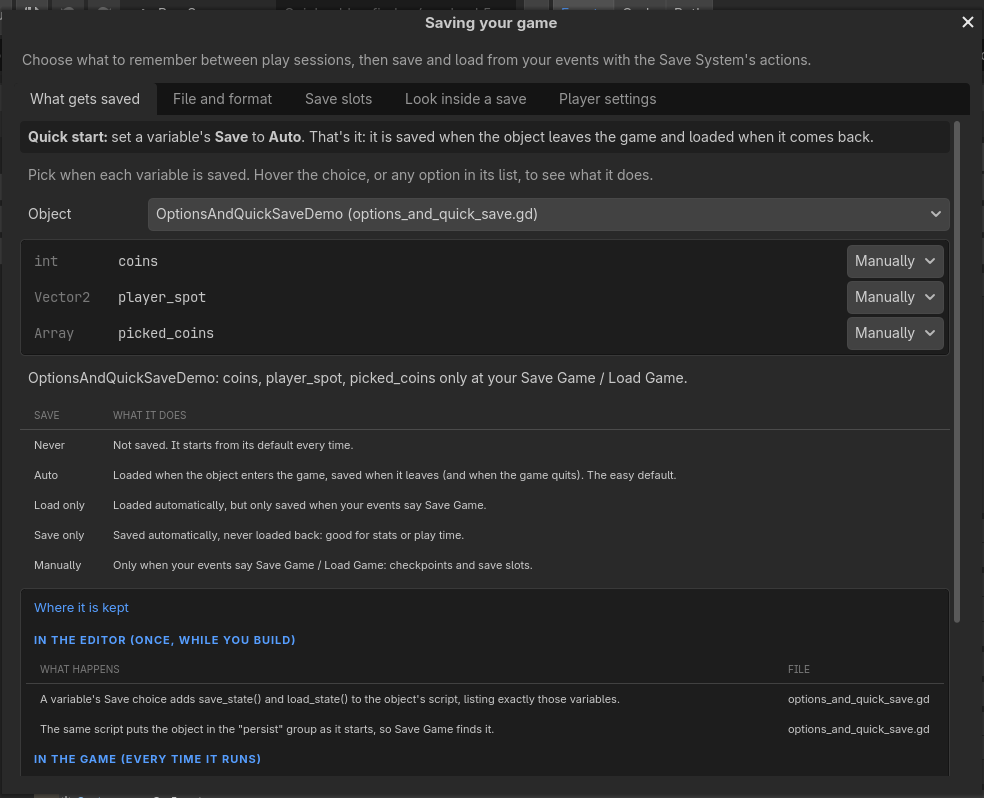
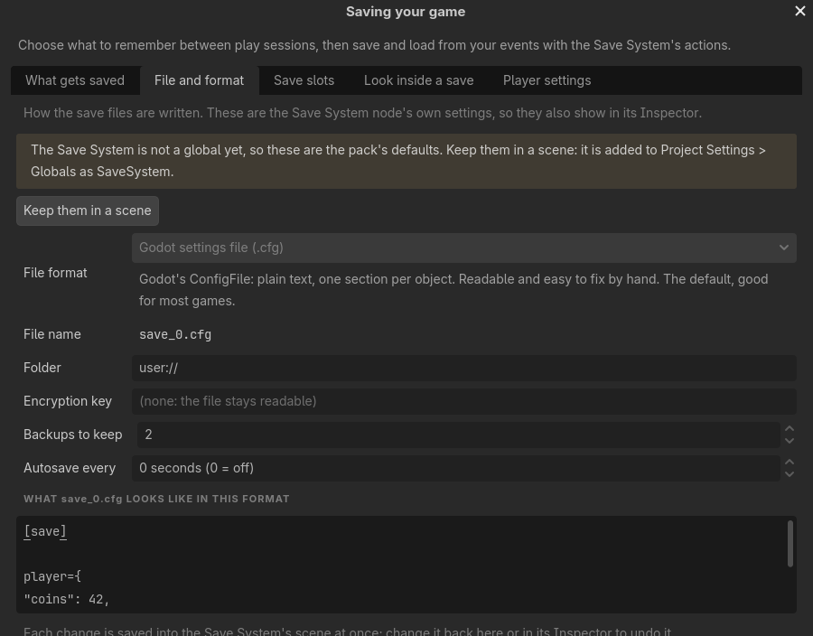
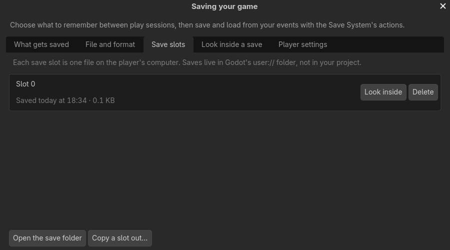
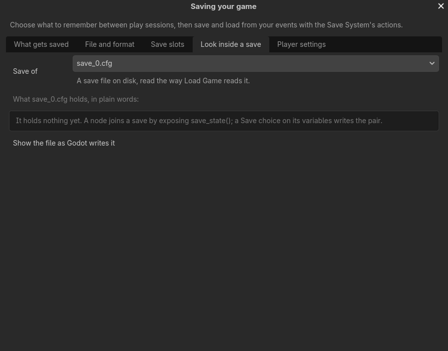
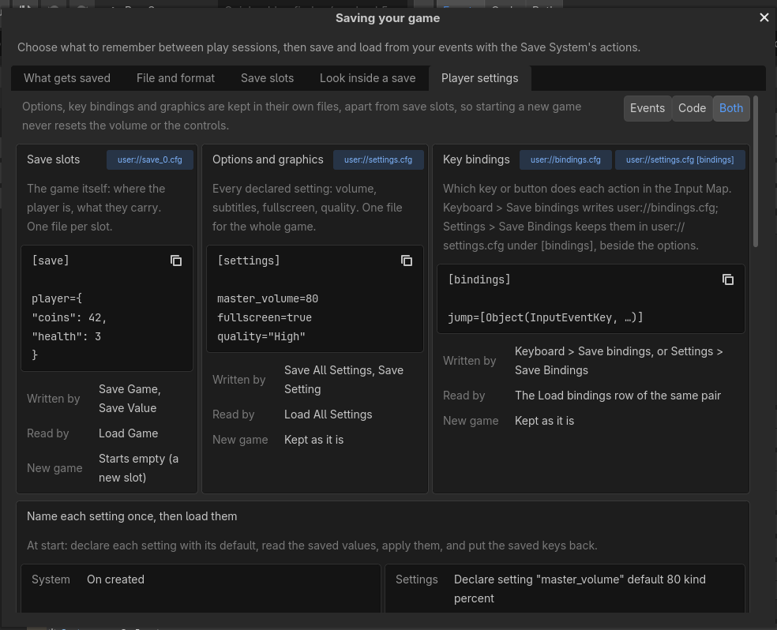

# Using the Save Studio

Working on a game's save files usually means running the game, saving, hunting for the file under `user://`, and opening it in a text editor to see what actually landed on disk. The Save Studio collapses that whole loop into one editor window, titled "Saving your game". It has five tabs: choose when each variable of a sheet is saved, set how the save files are written, look at the slot files your project has already written, read one of them in plain words, and see the separate files a game keeps for its player - options, key bindings and graphics. It is built directly on the Save System pack and the project-wide save-state seam, so everything it shows you is the real thing, not an approximation.

This guide walks through each tab in order, shows the matching code API for people who want to script it, and finishes with a playable example, concrete use cases and a list of common pitfalls. For the bigger picture of how saving works across a whole project - the persist group, the lifecycle triggers, targeted versus whole-game saving - see the "Saving and Loading Your Game" guide, which is the companion to this one.



## Table of Contents

1. [Opening the Save Studio](#1-opening-the-save-studio)
2. [Background you need first](#2-background-you-need-first)
3. [Tab 1: What gets saved](#3-tab-1-what-gets-saved)
4. [Tab 2: File and format](#4-tab-2-file-and-format)
5. [Tab 3: Save slots](#5-tab-3-save-slots)
6. [Tab 4: Look inside a save](#6-tab-4-look-inside-a-save)
7. [Tab 5: Player settings](#7-tab-5-player-settings)
8. [Try it: options, controls and a quick save](#8-try-it-options-controls-and-a-quick-save)
9. [Doing it from code](#9-doing-it-from-code)
10. [Use Cases](#10-use-cases)
11. [Joining an existing project](#11-joining-an-existing-project)
12. [Tips and Common Mistakes](#12-tips-and-common-mistakes)

## 1. Opening the Save Studio

There are two ways to open the window.

- In the event sheet dock, open the **Tools** menu and choose **Save Studio...**.
- Press **Ctrl+Shift+P** to open Godot's Command Palette, type **Save Studio**, and run the matching command.

Either route opens the same window. It does not need the game to be running, and it does not modify your project just by being open. The five tabs across the top are **What gets saved**, **File and format**, **Save slots**, **Look inside a save** and **Player settings**. Right-clicking a variable on the sheet and choosing **Save Choice...** opens the same window on the first tab.

The game never calls this window. A game calls the **SaveSystem** and **Settings** globals (the Save System and Game Settings packs); the window shows you what those write.

## 2. Background you need first

Two ideas make the rest of the window make sense.

The first is the **save-state seam**. A node takes part in saving by exposing two plain methods: `save_state() -> Dictionary`, which returns a plain-data snapshot of everything it is tracking, and `load_state(state: Dictionary)`, which puts that snapshot back. There is no base class to inherit and nothing to register. The Save System recognises the pair by duck typing - any node that has both methods participates automatically. Every stateful bundled behavior (StatForge, Health, Currency Ledger, and many more) already ships this pair.

The second is the set of **save formats**. The Save System writes its slot files to `user://`, and its `format` Inspector property picks how the data is laid out on disk. There are six choices, and all six preserve exact value types:

- **config** - a Godot ConfigFile, extension `.cfg`.
- **json** - readable JSON text, extension `.json`.
- **binary** - compact `store_var` bytes, extension `.sav`.
- **csv** - spreadsheet-style rows, extension `.csv`.
- **ini** - a portable `[section]` `key=value` file, extension `.ini`.
- **xml** - structured entry tags, extension `.xml`.

## 3. Tab 1: What gets saved

**Quick start:** set a variable's **Save** to **Auto**. That is the whole job: the variable is saved when the object leaves the game and loaded when it comes back.


The **Object** dropdown lists the open sheets; picking one switches the editor to it. Under it is one line per variable of that sheet - its type and name exactly as written, its own description, and a **Save** dropdown. Constants and object references (a Node, a Texture, anything that points at a thing rather than holding a value) are not listed, because there is nothing in them to save. Hover any choice in the dropdown to read what it does and what it is usually for; the closed dropdown's own tooltip is the chosen one's sentence.

| Save | What it does | Use for |
|---|---|---|
| **Never** | Not saved. It starts from its default every time. | timers, cooldowns, anything worked out again each run |
| **Auto** | Loaded when the object enters the game, saved when it leaves (and when the game quits). | health, coins, unlocked doors |
| **Load only** | Loaded automatically, but only saved when your events say Save Game. | settings you write yourself at a menu |
| **Save only** | Saved automatically, never loaded back. | play time, total jumps, stats you read elsewhere |
| **Manually** | Only when your events say Save Game / Load Game. | checkpoint position, quick save, save-slot games |

Under the list one sentence tells the whole story in words, for example *Player: health, coins come back by themselves; position only at your Save Game / Load Game.* Every pick is one undo step.

**What it writes.** The choice is stored on the variable, and saving the sheet writes plain Godot code for it at the end of the script - nothing in it needs the plugin:

```gdscript
## Saved by each variable's Save choice (Save Studio > What gets saved) - change the choice, not these lines.
@onready var __ef_save_boot: bool = _ef_load_saved()

func _ef_load_saved() -> bool:
	add_to_group("persist")
	var __remember_cfg: ConfigFile = ConfigFile.new()
	if __remember_cfg.load("user://remembered.cfg") == OK:
		health = __remember_cfg.get_value("Player", "health", health)
	tree_exiting.connect(_ef_store_saved)
	return true

func _ef_store_saved(at_save_game: bool = false) -> void:
	var __remember_cfg: ConfigFile = ConfigFile.new()
	__remember_cfg.load("user://remembered.cfg")
	__remember_cfg.set_value("Player", "health", health)
	__remember_cfg.save("user://remembered.cfg")

func save_state() -> Dictionary:
	return {
		"health": health,
		"position": position
	}

func load_state(state: Dictionary) -> void:
	if state.is_empty():
		return
	health = int(state.get("health", health))
	position = state.get("position", position)
```

When every choice is Manually there is no store function and the block is shorter: just `_ef_load_saved()` (which joins the `persist` group) and the `save_state()` / `load_state()` pair.

**Where it is kept.** The bottom of the tab says which step writes which file:

- In the editor, once: the Save choices add `save_state()` and `load_state()` to the object's script, listing exactly those variables, and the same script puts the object in the `persist` group as it starts, so Save Game finds it.
- In the game, every run: Auto and Load only variables load from `user://remembered.cfg` when the object enters the tree (`_ready`); Auto and Save only ones are written there when it leaves (`_exit_tree`) or the game quits. **Save Game** asks every `persist` object for `save_state()` and writes one file per slot (`user://save_0.cfg`), **Load Game** reads that slot back through `load_state()` and then fires On After Load, and **Save Number** / **Save Value** keep single values in the same slot file under their own name. Everything lives on the player's computer, never in `res://`.

The values live under the sheet's class name in `user://remembered.cfg` (or under `vars` for a sheet with no class name), the same file and section the older **Remember Between Runs** option used, so a game that remembered values before keeps them. A sheet that already writes its own `save_state()` or `load_state()` keeps that pair: the compiler writes the rest of the block without it, so Auto, Load only and Save only variables still load and save by themselves, while Manual - which is only the pair - saves nothing, and the compile warnings say so. Opened again, the generated block reads back as the choices it came from, and the file saves byte for byte.

## 4. Tab 2: File and format



This tab holds the Save System node's own settings, so they also show in its Inspector.

- **File format** - the kind of file each slot is written as (the six formats above). The file name's ending follows it.
- **File name** - each slot gets its own file; the number is the slot (`save_0.cfg`).
- **Folder** - where save files go. `user://` is the player's own data folder.
- **Encryption key** - optional. With a key the file is encrypted, so players cannot read or edit it in a text editor.
- **Backups to keep** - how many older copies of each slot to keep, for Restore Slot From Backup.
- **Autosave every** - save by itself every few seconds; 0 means only when your events say Save Game.
- **Keep them in a scene** - saves the Save System node as `res://save_system.tscn` and points the `SaveSystem` global at it, so its settings can change here and in the Inspector. If that file already exists, nothing is overwritten and the window says so.

A short preview under the settings shows what a slot in the chosen format looks like.

## 5. Tab 3: Save slots



Each save slot is one file on the player's computer. Saves live in Godot's `user://` folder, not in your project.

- **The slot list** shows every file that matches the file name pattern, with when it was saved ("a moment ago", "today at ...", "yesterday at ...") and how big it is. **Look inside** opens it on the next tab; **Delete** asks first, and Ctrl+Z cannot bring a deleted save back.
- **Open the save folder** shows the folder in your operating system's file manager.
- **Copy a slot out...** copies a slot file anywhere on disk, for a bug report or a backup.
- **Players can open their save folder** (under *For your players, in the game*) adds an **Open Save Folder** action, so a button in your menu can show players where their saves are. On the web and on phones there is no folder to show; the **Can Open Save Folder** condition lets you hide the button.

## 6. Tab 4: Look inside a save



**Save of** picks a save slot on disk, the node selected in the scene, or a bundled pack. Under it, **What save_0.cfg holds, in plain words** lists each name with its value (`coins  2`, `player_spot  Vector2(342, 188)`). For a node or a pack it shows what Save Game would write for it right now, from its default values. **Show the file as Godot writes it** reveals the raw text, or a short hex preview for a binary file.

## 7. Tab 5: Player settings



Options, key bindings and graphics are kept in their own files, apart from save slots, so starting a new game never resets the volume or the controls. Three cards say what each file is:

| File | What is in it | Written by | Read by |
|---|---|---|---|
| `user://save_0.cfg` | The game itself: where the player is, what they carry. One file per slot. | Save Game, Save Value | Load Game |
| `user://settings.cfg` | Every declared setting: volume, subtitles, fullscreen, quality. One file for the whole game. | Save All Settings, Save Setting | Load All Settings |
| `user://bindings.cfg`, and `user://settings.cfg` under `[bindings]` | Which key or button does each action in the Input Map. | Keyboard > Save bindings, or Settings > Save Bindings | the Load bindings row of the same pair |

The Key bindings card names both places because the bindings can be kept either way: the Keyboard object's rows write their own file, and the Game Settings pack keeps them in its settings file, beside the options. Use one pair or the other, never half of each. The settings file's name is the pack's `settings_file` property (default `user://settings.cfg`).

Below the cards are six uses, each as the rows on a sheet, as the GDScript it compiles to, or both (the **Events / Code / Both** switch): naming each setting once, doing what a setting means, a slider on the options screen, keeping them when the menu closes, letting players rebind a key, and graphics with a way back.

## 8. Try it: options, controls and a quick save

The **Options and Quick Save** showcase (`demo/showcase/options_and_quick_save/`) keeps the three kinds of thing a game saves, each where this window says it goes. Open its scene and press play.

1. Press **Tab** (or the pad's Y) to open the options. Drag **Master volume** to 30 and tick **Fullscreen**. On the controls page, click the keyboard button of **Open Options** and press **O**. Press **Back**. That wrote `user://settings.cfg`: the two settings under `[settings]` and the controls under `[bindings]`.
2. Walk with the arrow keys and pick up two coins. Press **F5**: *Saved (slot 0)* appears. That wrote `user://save_0.cfg` with `coins`, `player_spot` and `picked_coins`.
3. Stop the game and run it again. The volume is 30, the window is fullscreen, and **O** opens the options: the options and the controls came back by themselves. You have no coins and the player is at the start, because the game itself comes back only when you ask.
4. Press **F9**. The coins, the places you picked them up and where the player stood are back.

Now open this window on the showcase's sheet. **What gets saved** reads *coins, player_spot, picked_coins only at your Save Game / Load Game*: all three are set to **Manually**, which is why F5 and F9 do all the work. **Save slots** lists `save_0.cfg`, and **Look inside a save** shows `coins 2` and the `player_spot`. **Player settings** names the other two files.

One thing to know when you look inside the slot: it also lists `Settings/values/master_volume` and `fullscreen`. In the showcase the Game Settings pack is a child node of the saved object, and Save Game also snapshots the behaviours that sit on a saved node. In your own project the pack is an autoload, not a child of a saved node, so the slot holds only what you chose.

The quick save keys are ordinary controls (`quick_save` and `quick_load`), so the player can rebind them on the controls page, and the strip along the bottom reads the live binding. In your own project the packs are the `Settings` and `SaveSystem` autoloads, so the rows read `Settings.save_all_settings()` and `SaveSystem.save_game()`; in the showcase they are child nodes of the same names, so the rows read `$Settings.` and `$SaveSystem.`.

## 9. Doing it from code

Everything the Save Studio does by hand is also available on the public `EventSheets` API, which is what build tools and tests call:

- `EventSheets.save_state_code(fields)` returns a `save_state` / `load_state` pair for any list of fields, in the same convention the Save choices write.
- `EventSheets.persistable_fields(path)` scans a script and returns its variables with the plain-data / object-reference classification.
- `EventSheets.preview_save(data, format)` renders a snapshot in a chosen format, the same text the file previews show.
- `EventSheets.save_capable_scripts()` lists the bundled addons that ship the seam.

If you want to fold any of this into your own build scripts or automated checks, the "Building on EventSheets" guide documents the full API surface.

## 10. Use Cases

1. **Compare JSON and binary before shipping.** Pick a format on File and format, run the game, save, and read the slot on Look inside a save with **Show the file as Godot writes it**. Switch the format and save again; you can decide with your own eyes whether the readability of json is worth the extra bytes.

2. **Convert an existing config save to readable JSON for modders.** Set the format to json, save in the game, and use **Copy a slot out...** to hand modders a clean JSON file they can read and edit, without touching the game code.

3. **Send a player's save to a bug report.** Ask for their save file, drop it under `user://`, open Save slots, **Look inside** to read it, and **Copy a slot out...** to attach it to the ticket. The exact save that reproduces the bug travels with the report.

4. **Check what a StatForge node actually stores.** On Look inside a save, pick StatForge in **Save of**. The panel shows precisely which fields StatForge writes and in what shape, far faster than reading the pack source.

5. **Keep coins and health between play sessions in one click each.** Open the player's sheet, go to What gets saved, and set `coins` and `health` to **Auto**. Close the game and start it again: they come back by themselves.

6. **Hand a sample of the XML to an external pipeline.** If a separate tool in your pipeline consumes XML, set the format to xml, save once, and hand over the slot file as the sample of the exact tag structure it will receive.

7. **Hand-inspect a live save file.** Run the game, save, come back to the Save slots tab and press **Look inside** on the newest slot to read its real contents. This is how you confirm live gameplay data actually made it to disk.

8. **Open a save in a spreadsheet.** Set the format to csv, save, and copy the slot out. Opening the CSV in a spreadsheet program lets you scan rows of saved values in a familiar grid, useful for balancing or sanity-checking numbers.

9. **A checkpoint that only moves when you say so.** Set the player's `position` to **Manually** and put Save Game on the checkpoint's On Enter event. The position is written only there, and Load Game puts the player back on it.

10. **A quick save and a quick load.** Set the variables to **Manually**, make `quick_save` and `quick_load` controls, and put Save Game under **Event is action pressed quick_save** and Load Game under **quick_load**. The Options and Quick Save showcase does exactly this on F5 and F9.

11. **Verify a node's behaviors all persist.** Select your composed scene node in the editor so it shows up as **Selected node: ...** in **Save of**. Because it walks the node plus its behavior children, you can confirm every behavior you expected to save is present.

12. **Open the save folder to back up or clear saves.** Use **Open the save folder** on the Save slots tab to jump straight to `user://` in your file browser, where you can copy the saves somewhere safe or delete them to test a fresh first-run.

13. **Keep the volume when a new game starts.** Declare the volume as a setting and save it with **Save All Settings**. It lives in `user://settings.cfg`, apart from the slots, so deleting a save or starting over never resets it.

14. **Remember the player's controls.** Rebind with the Game Settings controls page and **Save Bindings**, then **Load Bindings** at start. The Input Rebind showcase shows the whole screen.

15. **Let players find their own saves.** Tick **Players can open their save folder** and put the **Open Save Folder** action on a button, so a player can back up or share a save without hunting for the folder.

16. **Point the options at a file of their own.** In a project that already has a `user://settings.cfg`, set the Settings node's `settings_file` to another path (in the Inspector once the node is in a scene, or in code before Load All Settings), and the two systems stop sharing one file.

17. **A settings page that survives a crash.** Call **Save All Settings** and **Save Bindings** from the Back button, as the showcase does, not only at quit, so a closed window or a crash never costs the player their choices.

**Other use cases**

- **Seeing what a teammate's loader will read.** Look inside a save shows the keys exactly as written, so a teammate who reads the file with `ConfigFile` knows what to ask for.
- **Testing a first run.** Delete the slot from Save slots, run again, and the game starts from its defaults.
- **Checking an upgrade.** Keep an old slot, change the shape of a saved variable, and Look inside to see what the new build will find.
- **Teaching the three files.** Open Player settings on a fresh project to explain slots, settings and bindings to a new teammate in one picture.
- **Choosing Manually for a roguelike.** Set run state to **Manually** so only the Save and Quit door writes it, and never a crash mid-run.

## 11. Joining an existing project

- **Nothing is rewritten unless you ask.** The Save System only writes the files its `file_pattern` names in its `save_directory` (`user://save_0.cfg` by default), the plugin never writes `project.godot`, and a variable is saved only when you give it a Save choice.
- **A sheet that already writes its own pair keeps it.** A hand-written `save_state()` / `load_state()` is never replaced; the choices add only the loading and storing beside it.
- **A teammate without the plugin reads plain Godot.** The scripts hold plain typed code (`SaveSystem.save_game()`, the `save_state()` pair under a line saying *change the choice, not these lines*). In the default `config` format a slot is a ConfigFile: your values are under the section `save`, the nodes in the `persist` group are under `__persist` keyed by node path, and the pack's own bookkeeping is under `__card`, `__version`, `__addons` and `__run`.
- **The files on disk** are `user://save_0.cfg` (the slot), `user://settings.cfg` (options, and bindings if the Settings pair is used), `user://bindings.cfg` (bindings, if the Keyboard pair is used) and `user://remembered.cfg` (only when a variable is set to Auto, Load only or Save only).
- **A project that already keeps `user://settings.cfg`.** The Settings pack loads the file first and rewrites only its own sections, so another section survives; code that writes a fresh ConfigFile there without loading it first would wipe them. Give the pack its own file with `settings_file`.

## 12. Tips and Common Mistakes

- **Object references are left out on purpose.** What gets saved does not list a Node, Resource, or RandomNumberGenerator variable. Those are live pointers, not plain data, and forcing one into a save file would store something meaningless.

- **Manually saves nothing by itself.** A variable set to Manually is written only by Save Game and read only by Load Game. If your quick save does nothing, check that Save Game is actually called, and that the sheet is the one in the `persist` group.

- **Hidden things do not come back by themselves.** Only the variables you save are saved. In the showcase a picked-up coin stays picked up because its name is kept in `picked_coins`; a coin you forgot to track would reappear.

- **Use one bindings pair.** The Keyboard rows write `user://bindings.cfg` and the Settings rows write `user://settings.cfg`. Saving with one and loading with the other finds nothing.

- **Change the choice, not the generated lines.** The block at the end of the script is rewritten from the Save choices every time the sheet is saved. If your script needs to save something a variable cannot hold, or to massage a value on the way in or out, write your own `save_state()` / `load_state()` instead - a sheet that has its own pair keeps it, and the choices then add only the loading and storing beside it.

- **The slot list reads the folder when you open it.** If you saved in a running game and do not see the file, reopen the tab to re-read `user://`.
